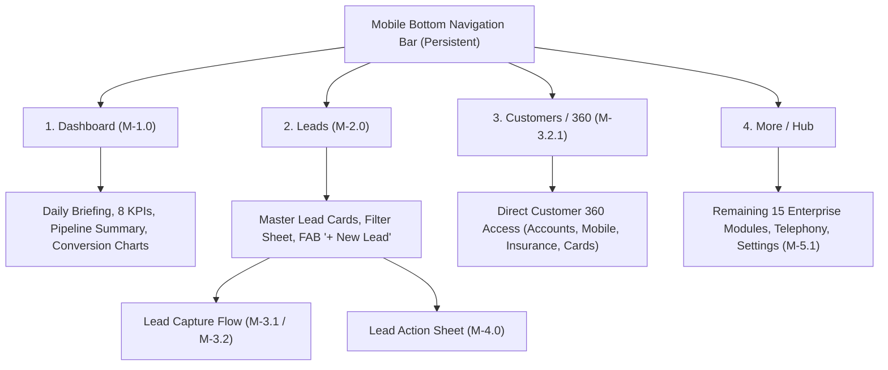

# Mobile Navigation Architecture & Shell Framework: Kati Enterprise Sales Module

> **Document Version:** 1.0.0  
> **Source Baseline:** `reference/sales-module-source.pdf` / `design/ux-architecture.md`  
> **Target Platform:** Mobile (iOS / Android / Flutter Cross-Platform)  
> **Status:** Phase 2 Architecture Specification

---

## 1. Executive Summary & The Mobile Paradigm Shift

The desktop Kati CRM application relies on an extensive dual-navigation frame:
* **18 Persistent Sidebar Modules:** Competing for attention in a permanent left rail.
* **6 Horizontal Sales Sub-Tabs:** Overflowing viewports below 1200px.
* **Buried Customer 360 Gateway:** Inaccessible except by initiating an existing customer lead and clicking a tiny avatar inside the left sidebar mini-card.

The **Kati Mobile Navigation Framework** eliminates these desktop bottlenecks by introducing a focused, hierarchical, thumb-friendly navigation shell built on industry-standard mobile patterns:

```
┌────────────────────────────────────────────────────────┐
│ [kati] DTB Africa             (● Online▾)  [🔔8]  [👤] │  <-- Top App Bar (56px)
├────────────────────────────────────────────────────────┤
│                                                        │
│                                                        │
│               ACTIVE SCREEN WORKSPACE                  │
│             (Dashboard / Leads / 360)                  │
│                                                        │
│                                                        │
├────────────────────────────────────────────────────────┤
│  [📊 Dashboard]   [👥 Leads]   [🏢 Customers]  [⋯ More] │  <-- Bottom Nav (64px)
└────────────────────────────────────────────────────────┘
```

---

## 2. The 4-Tab Bottom Navigation Bar (Primary Hierarchy)

The primary navigation bar sits persistently at the base of the viewport (height **64px** plus system safe area inset). It organizes 100% of the sales representative's daily operations into four distinct tabs:



### 2.1 Tab 1: Dashboard (`Screen M-1.0`)
* **Icon:** `LayoutDashboard` / `BarChart3`
* **Label:** "Dashboard"
* **Functional Scope:**
  * Executive and operational overview of sales performance.
  * 8 KPI Performance cards displayed in an ergonomic horizontal carousel.
  * Lead Pipeline overview transformed into interactive status chips.
  * Responsive, vertically stacked Lead Conversion Trend and Product Interest Distribution charts.
  * Dedicated date and branch filter trigger.

### 2.2 Tab 2: Leads (`Screen M-2.0`)
* **Icon:** `Users` / `Target`
* **Label:** "Leads"
* **Functional Scope:**
  * Master operational leads list (transforming the 14-column desktop table).
  * Quick-search bar and sticky Filter trigger chip (`Filter (N)`).
  * 7 status counter pills at the top (`All`, `New`, `Warm`, `Hot`, `Cold`, `Converted`, `Lost`).
  * Floating Action Button (FAB) anchored in the bottom right: `+ New Lead` (triggers Screen M-3.1 / M-3.2).
  * Lead Card tap -> navigates to Lead Details (Screen M-4.4.1).
  * Action button tap -> opens Mobile Action Sheet (Screen M-4.0).

### 2.3 Tab 3: Customers (`Screens M-3.2.1 – M-3.2.4`) — *The Architectural Fix*
* **Icon:** `Building2` / `UserCheck`
* **Label:** "Customers"
* **Functional Scope:**
  > [!IMPORTANT]
  > **Resolving the Source Pain Point:**  
  > The source PDF explicitly stated: *"Pain point: Unable to have an action to view customer profile from the leads table"*. On desktop, Customer 360 was completely hidden behind an avatar in a sidebar mini-card.  
  > On mobile, **Customer 360 is elevated to a primary bottom navigation tab**. Users can directly search, look up, and audit any DTB customer's core accounts, mobile banking registrations, bancassurance policies, credit cards, compliance, and multi-channel history without having to start a dummy lead creation form!

### 2.4 Tab 4: More / Hub
* **Icon:** `Grid` / `MoreHorizontal`
* **Label:** "More"
* **Functional Scope:**
  * Acts as the mobile gateway to the other 15 enterprise modules present in the desktop sidebar:
    1. **Sales & Revenue:** Opportunity, Orders, Collections, B2B
    2. **Telephony & Contact Center:** Call Reports, Queue Management (`Queue 8022`), Outbound Dialing
    3. **Customer Support:** Helpdesk, Branch Complaints, Branch Feedback, Customer Feedback
    4. **Governance & Reference:** Knowledge Base, Quality Assurance, Social Media, Campaign, Calendar
    5. **System & Profile:** Company Details & User Profile (Screen M-5.1), App Settings, Logout

---

## 3. Mobile Top Application Bar (Persistent Utilities)

The mobile top bar measures **56px in height** (excluding status bar) and delivers critical telephony, search, and notification awareness without cluttering the screen:

```
┌────────────────────────────────────────────────────────┐
│ [kati] DTB Africa             (● Online▾)  [🔔8]  [👤] │
└────────────────────────────────────────────────────────┘
```

1. **Left Brand Cluster:**
   * Kati CRM logo + DTB Africa institutional text badge.
2. **Center-Right Telephony Presence Pill (`Online ▾`):**
   * Displays agent state with a pulsing colored dot (Green = `Online`, Amber = `Busy`, Gray = `Offline`).
   * **Interaction:** Tapping opens a compact **Telephony & Presence Bottom Sheet**:
     * Toggle status (`Online`, `Away`, `Busy`, `Offline`).
     * Select active call queue (e.g., `Queue 8022 ▾`).
     * Toggle `PBX Softphone Login` switch.
3. **Notification Hub (`🔔8`):**
   * Bell icon with high-contrast badge counter (`8` to `212`). Tapping opens the notifications drawer.
4. **User Profile Avatar (`👤`):**
   * Displays logged-in user photo or initials (`Branson Allann`).
   * Tapping navigates directly to Screen M-5.1 (`Company Details / User Profile`).

---

## 4. Contextual Navigation & Modality Strategy

To ensure seamless transitions and eliminate desktop-style window clutter, modal dialogs and forms are mapped to standardized mobile navigation patterns:

| Desktop Pattern | Mobile Equivalent Pattern | Transition & Behavior | Applied Screens |
|---|---|---|---|
| **Full-page Multi-Card Form** | **Full-Screen Stepper / Scroll Flow** | Slides in from right (`Push route`). Fixed header with Back arrow, section progress bar, sticky bottom button bar. | Screen M-3.1 (New Lead), Screen M-3.2 (Existing Lead), Screen M-4.1 (Schedule Meeting) |
| **Row Ellipsis Dropdown (⋮)** | **Native Bottom Action Sheet** | Slides up from bottom (`Modal sheet`). Rounded top corners (16px), dark backdrop, 56px touch rows, drag handle. | Screen M-4.0 (Lead Actions Hub) |
| **Centered Desktop Dialog (Small)** | **Interactive Modal Bottom Sheet** | Slides up from bottom to 50–70% screen height. Virtual keyboard pushes sheet up gracefully. | Screen M-4.2 (Update Status), Screen M-4.3 (Reassign Lead) |
| **Two-Tab Desktop Dialog** | **Tabbed Full-Screen Hub with Segmented Control** | Dedicated mobile screen with sticky top `SegmentedControl` (`[ Profile ]` vs `[ Activity Log ]`). | Screens M-4.4.1 & M-4.4.2 (Lead Details Hub) |
| **Radio-Button View Panes** | **Horizontal Segmented Tabs** | Swipeable segmented tab strip beneath customer biodata header (`Accounts`, `Mobile`, `Insurance`, `Cards`). | Screens M-3.2.1 – M-3.2.4 (Customer 360 Hub) |
| **Desktop Filter Drawer** | **Full-Height Filter Sheet** | Slides up from bottom. Scrollable filter criteria with sticky bottom `Apply Filters (N)` button. | Screen M-2.0-F (Leads Filter Sheet) |

---

## 5. Thumb-Zone Ergonomic Mapping

```
┌────────────────────────────────────────┐
│ [Top Bar]  (Online▾) [🔔] [👤]         │  <-- Hard-to-reach Zone (Top 15%)
├────────────────────────────────────────┤      (Read-only headers, secondary icons)
│                                        │
│ Search Bar & Segmented Controls        │  <-- Natural Reach Zone (Middle 45%)
│                                        │      (Lead cards, biodata, input fields)
│ Scrollable Cards & Data Lists          │
│                                        │
├────────────────────────────────────────┤
│ Sticky Action Buttons / FAB [+]        │  <-- Prime Thumb Zone (Bottom 40%)
│ [Dashboard] [Leads] [Customers] [More] │      (Primary navigation, sheet triggers, CTAs)
└────────────────────────────────────────┘
```

### Ergonomic Design Rules:
1. **Primary CTAs at Viewport Bottom:** Actions like `Create Lead`, `Update Status`, `Apply Filters`, and the `+ New Lead` FAB are always anchored in the bottom thumb zone.
2. **No Critical Actions in Corners:** Delete icons and menu triggers are enclosed in minimum 48x48px bounding boxes with generous padding away from edge bezels.
3. **Swipe Gestures:**
   * Swipe right from left edge = Back navigation.
   * Swipe down on modal bottom sheet = Dismiss / Close.
   * Swipe horizontal on Customer 360 = Smooth page transition between `Accounts`, `Mobile Banking`, `Bancassurance`, and `Credit Card`.
