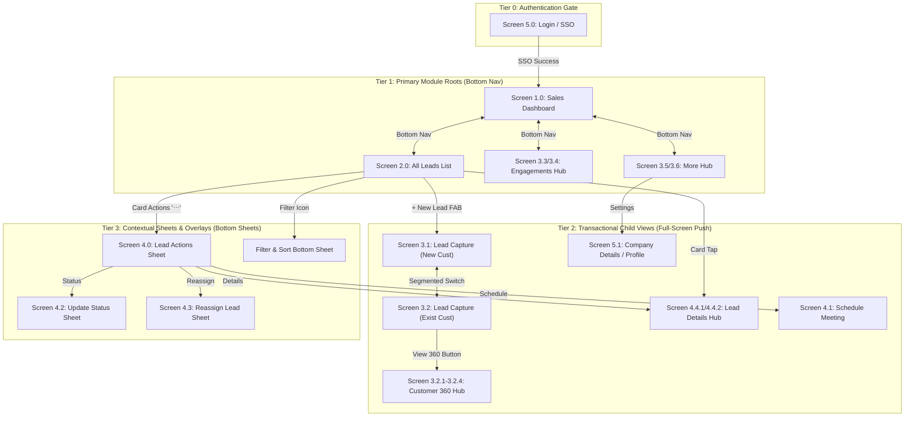

# Mobile Navigation Model & Screen Relationship Architecture: Kati CRM Sales Module

> **Document Version:** 2.0.0  
> **Target Application:** Kati CRM — Enterprise Banking Sales Module (Diamond Trust Bank Africa)  
> **Source Documents:** `design/screen-inventory.md`, `design/screen-mapping.md`, `design/mobile-ux-challenges.md`, `reference/sales-module-source.pdf`  
> **Status:** Mobile Navigation Architecture & Interaction Model (Approved for Implementation)  

---

## 1. Executive Summary & Mobile Navigation Strategy

The desktop-oriented Kati CRM Sales Module presents extreme density: 18 global CRM sidebar modules, 6 horizontal sub-navigation tabs, 14-column data tables, 6-column Kanban pipeline boards, split-pane multi-tier Customer 360 views, and row-anchored desktop dropdowns.

Attempting to compress these desktop patterns into mobile viewports (360px–430px) creates severe usability failures, including touch target violations, nested scroll traps, gesture collisions, and hidden entry points (notably the Customer 360 entry point tucked inside a sidebar mini-card).

This document establishes the **Mobile Navigation Model** for Kati CRM. It transforms the desktop application into a thumb-zone-optimized, mobile-first experience that preserves **100% of the underlying banking functionality, regulatory data, and audit integrity** without cluttering the mobile interface.

```
┌────────────────────────────────────────────────────────┐
│                   TOP APP BAR                         │
│  [☰ Modules]  Kati Sales Hub   [🔍 Search] [🔔 8] [👤]  │
├────────────────────────────────────────────────────────┤
│                                                        │
│                  ACTIVE VIEWPORT                       │
│                                                        │
│  [Screen 1.0 Dashboard / Screen 2.0 Leads List / etc.] │
│  - Vertical scrollable cards                           │
│  - Fast-filter chips                                   │
│  - Instant search debouncing                           │
│                                                        │
├────────────────────────────────────────────────────────┤
│             PERSISTENT BOTTOM NAVIGATION               │
│  [📊 Dashboard]   [👥 Leads]   [💬 Engagements]  [⋯ More]│
└────────────────────────────────────────────────────────┘
```

---

## 2. Component Selection & Ergonomic Rationale

Rather than forcing arbitrary UI patterns, each mobile navigation pattern is selected strictly where it solves an identified ergonomic or operational problem:

| Pattern | Selected Component | Location in Hierarchy | Usability Problem Solved |
|---|---|---|---|
| **Primary App Navigation** | Modal App Launcher Drawer | Top-left hamburger (`☰`) | Replaces the persistent 18-item desktop sidebar. Keeps 18 CRM modules accessible in 2 taps without consuming 25% of screen width. |
| **Sales Domain Navigation** | Bottom Navigation Bar (4 destinations) | Persistent bottom anchor (height: 64px) | Solves the 6-tab horizontal desktop sub-nav overflow. Places high-frequency daily sales destinations directly in the primary thumb reach zone. |
| **Secondary Submodule Access** | Top Segmented Tabs & "More" Hub | In-page headers & Tab 4 | Manages secondary submodules (`Customer Engagement`, `All Engagements`, `Collections`, `Report & Analytics`) without tab truncation. |
| **Global & Telephony Utilities** | Collapsible Top Utility Drawer | Top-right utility icon / User pill | De-clutters PBX login, telephony queue selector (`8022`), and agent presence status from the compact mobile app bar. |
| **Row-Anchored Workflows** | Mobile Bottom Sheet (`ModalBottomSheet`) | Screen bottom slide-up | Solves tiny 16x16px ellipsis hit-boxes and off-screen desktop dropdown clipping (Screen 4.0). Offers generous 52px touch targets. |
| **Complex Lead Intake** | Full-Screen Form Sheet (`Scaffold` push) | Full viewport with sticky action dock | Solves desktop modal nested-scroll collapse and keyboard occlusion for 17+ fields (Screens 3.1 & 3.2). |
| **Fast Pipeline Progression** | Half-Height Bottom Sheet | Triggered via card swipe or action sheet | Enables 5-second status updates (Screen 4.2) and reassignments (Screen 4.3) without leaving list context. |
| **Creation Shortcut** | Floating Action Button (FAB) | Bottom-right anchor (above bottom nav) | Provides single-tap instant access to `+ New Lead` from both the Dashboard and Leads list. |

---

## 3. Primary Application Navigation (Global CRM Shell)

### 3.1 The 18-Module Problem & Solution
The desktop system features 18 macro modules in a persistent left navigation drawer. On mobile, a persistent drawer is untenable. 

**Mobile Pattern: The Enterprise App Launcher Drawer**
* **Trigger:** Tapping the navigation icon (`☰`) on the top-left of the top app bar.
* **Component:** Modal slide-out drawer occupying 85% of screen width (max 340px) with background dimming scrim.
* **Information Architecture:** The 18 modules are organized into **4 logical operational clusters** rather than an unbroken 18-item list:

```
┌────────────────────────────────────────────────────────┐
│  [DTB Kati CRM]                   Agent: Branson Allan │
│  Current Queue: 8022 ▾   PBX: [✔] Logged In  ● Online ▾│
├────────────────────────────────────────────────────────┤
│  CORE RELATIONSHIP & SALES                             │
│  ⭐ Sales (Active Module)                              │
│  • Contacts (Customer 360)                             │
│  • Opportunity                                         │
│  • B2B Commercial Banking                              │
│  • Orders                                              │
├────────────────────────────────────────────────────────┤
│  CUSTOMER SERVICE & ENGAGEMENT                         │
│  • Helpdesk & Tickets                                  │
│  • Social Media Feeds                                  │
│  • Branch Complaints                                   │
│  • Branch Feedback                                     │
│  • Customer Feedback & CSAT                            │
├────────────────────────────────────────────────────────┤
│  OUTREACH & TELEPHONY OPERATIONS                       │
│  • Call Reports & Logs                                 │
│  • Outbound Dialing                                    │
│  • Queue Management                                    │
│  • Marketing Campaigns                                 │
│  • Calendar & Appointments                             │
├────────────────────────────────────────────────────────┤
│  GOVERNANCE, QUALITY & INSIGHTS                        │
│  • Analytics & BI                                      │
│  • Quality Assurance (QA)                              │
│  • Knowledge Base (SOPs)                               │
├────────────────────────────────────────────────────────┤
│  ⚙️ Company & User Settings (Screen 5.1)               │
│  🚪 Log Out (Returns to Screen 5.0)                    │
└────────────────────────────────────────────────────────┘
```

### 3.2 Header Telephony & Presence Controls
The desktop top bar contains PBX controls that crowd mobile headers:
* On mobile, the Top App Bar displays only the essential presence status dot (Green for `Online`, Amber for `Busy`, Gray for `Offline`) overlaid on the user avatar.
* Tapping the user avatar or drawer header expands a quick **Telephony Control Sheet**:
  - Agent Presence Toggle (`Online` / `Busy` / `Offline`)
  - Queue Assignment Selector (`Current Queue: 8022 ▾`)
  - Softphone PBX Authentication toggle (`PBX Login`)

---

## 4. Sales Module Navigation & Submodule Architecture

### 4.1 The 4-Destination Bottom Navigation Bar
The Sales Module submodules are mapped into a dedicated bottom navigation bar:

```
┌──────────────┬──────────────┬──────────────┬──────────────┐
│     📊       │      👥      │      💬      │      ⋯       │
│  Dashboard   │    Leads     │ Engagements  │     More     │
└──────────────┴──────────────┴──────────────┴──────────────┘
```

1. **Tab 1: Dashboard (`Screen 1.0`):** Executive overview, 8 KPI performance summary metrics, 6-stage pipeline distribution, conversion trend line chart, and product interest distribution donut chart.
2. **Tab 2: Leads (`Screen 2.0`):** Core operational workhorse. 7-status summary metrics, searchable/filterable lead list cards, card swipe actions, and `+ New Lead` FAB.
3. **Tab 3: Engagements (`Submodules 3.3 & 3.4`):** Unified mobile engagement hub with top segmented controls:
   - Segment `[ Customer Engagements ]`: Customer-specific sales touchpoints and tasks.
   - Segment `[ All Engagements ]`: Omnichannel interaction timeline (calls, chats, meetings, emails).
4. **Tab 4: More (`Submodules 3.5 & 3.6` + Settings):** Clean grid/list hub accessing:
   - `Collections`: Debt recovery and arrears-assisted follow-ups.
   - `Report & Analytics`: Branch attribution, conversion funnels, and agent performance reports.
   - `Company & Settings` (`Screen 5.1`): Enterprise profile, API keys, tax setup, and password management.

### 4.2 Floating Action Button (FAB) Placement
* **Position:** Anchored at bottom-right, 16px above the Bottom Navigation Bar (`bottom: 80px, right: 16px`).
* **Availability:** Persistent on **Tab 1 (Dashboard)** and **Tab 2 (Leads)**.
* **Label / Icon:** `+ New Lead` (extended FAB on initial scroll, collapses to `+` during active scroll down to maximize screen estate).
* **Action:** Direct push to **Screen 3.0 Lead Capture Router** (defaulting to New Customer or last-used mode).

---

## 5. Contextual Navigation & In-Page Mechanics

### 5.1 Card-Level Contextual Actions (Replacing Screen 4.0 Dropdown)
On desktop Screen 2.0, each row ended with a tiny 16px `⋮` icon opening a cramped floating popup menu.

**Mobile Implementation: Contextual Bottom Action Sheet**
* **Triggers:**
  1. Tapping the explicit 48x48px action icon (`⋯`) on any Lead card.
  2. Long-pressing anywhere on the Lead card.
  3. Swiping the card from right-to-left to reveal quick actions.
* **Action Sheet Layout:**
  - Header: Lead ID (`L-2026-000184`), Customer Name (`Zamzam Hassan Mohamed`), Current Status (`Warm`).
  - Action Grid / List with clear icons, descriptive labels, and minimum 52px touch targets:
    1. `📅 Schedule Meeting` (Screen 4.1) — Opens full-screen event scheduler.
    2. `🔄 Update Status` (Screen 4.2) — Opens half-height status bottom sheet.
    3. `👥 Reassign Lead` (Screen 4.3) — Opens half-height team reassignment sheet.
    4. `👁️ View Details` (Screens 4.4.1 & 4.4.2) — Pushes full Lead Detail view.
    5. `📄 Export as PDF` — Dispatches background download notification.
    6. `✉️ Export as PDF via Email` — Asynchronously dispatches email and shows snackbar confirmation.

### 5.2 Swipe Gestures on Lead Cards
To dramatically accelerate field sales productivity, cards support horizontal gesture shortcuts:
* **Swipe Left-to-Right (Green):** Quick Call / Telephony dialer trigger. Immediately launches phone dialer with customer MSISDN pre-loaded.
* **Swipe Right-to-Left (Blue):** Quick Action trigger. Reveals `Update Status` and `Schedule Meeting` buttons without opening the full action sheet.

---

## 6. Screen Hierarchy & Back Navigation Model

### 6.1 Architectural Hierarchy Tiers



### 6.2 Back Navigation Rules & Mental Model

1. **Bottom Navigation Roots (Tier 1):**
   - Each bottom nav tab maintains its own independent navigation stack.
   - If the user is on Tab 2 (`Leads`), Tab 3 (`Engagements`), or Tab 4 (`More`) and presses the system back button (Android back gesture/button), the application switches back to Tab 1 (`Dashboard`) before exiting the application.
   - If the user is on Tab 1 (`Dashboard`) and presses back, the OS prompts with an app exit confirmation dialog ("Press back again to exit").

2. **Pushed Detail & Creation Screens (Tier 2):**
   - Top-Left App Bar contains a standard back chevron (`←`) or close icon (`✕`).
   - Supports edge-swipe-back gestures (iOS interactive swipe from left edge; Android back gesture).
   - **Dirty State Guard:** For forms with unsaved modifications (`Screen 3.1`, `Screen 3.2`, `Screen 4.1`), tapping back or edge-swiping triggers a modal confirmation:
     *"Discard Unsaved Changes? All information entered in this lead will be lost."* Options: `[ Keep Editing ]` and `[ Discard ]`.

3. **Contextual Bottom Sheets (Tier 3):**
   - Dismissible via:
     1. Swiping down on the sheet handle bar (`drag_handle`).
     2. Tapping anywhere on the dimmed background scrim.
     3. Tapping the explicit top-right `✕` button.
     4. Pressing the system back button (dismisses the sheet without popping the underlying view).

---

## 7. Search, Filtering & Sorting Architecture

### 7.1 Search Mechanics
* **Location:** Persistent sticky search bar embedded at the top of Screen 2.0 (`All Leads`).
* **Placeholder:** `Search by Customer, Lead ID, Phone, Branch...`
* **Interaction:**
  - Real-time debounced search (300ms delay) filters the lead cards dynamically.
  - Active search displays a clear icon (`✕`) on the right edge.
  - Tapping into the search field elevates the search bar, pushes quick-search history pills (`Recent Searches: Zamzam, KES 1M+, Ravenclaw`), and dims the list until input begins.

### 7.2 Filtering Mechanics (Replacing the 9-Field Screen Hogging Panel)
Desktop Screen 2.0 used a collapsible 9-input filter box that pushed the data table completely off-screen.

**Mobile Solution: Dual-Tier Filtering**
1. **Tier A: Fast-Access Horizontal Filter Chips (Sticky Header):**
   - Positioned directly below the search bar on Screen 2.0.
   - Horizontal scrollable pill bar:
     `[ All (36) ]  [ Hot (1) ]  [ Warm (4) ]  [ Cold (4) ]  [ Nurturing (1) ]  [ Converted (4) ]  [ Lost (3) ]`
   - Single tap immediately filters the list cards and updates the active pill in solid orange.
2. **Tier B: Comprehensive Multi-Attribute Filter Bottom Sheet:**
   - Triggered by tapping the Filter Funnel button `[ Filters ⏷ (X) ]` in the search header.
   - Slides up as an 85%-height bottom sheet with clean, touchable controls:
     - **Lead Status:** Multi-select chips (`New`, `Cold`, `Warm`, `Hot`, `Nurturing`, `Converted`, `Lost`).
     - **Customer Segment:** Multi-select chips (`Retail`, `Corporate`, `Business`).
     - **Priority:** Color-coded selector chips (`High`, `Medium`, `Low`).
     - **Assigned Officer:** Searchable bottom sheet picker (replaces small desktop dropdown).
     - **Branch:** Searchable bottom sheet picker (`Courtyard`, `Ravenclaw`, `Griffindor`, etc.).
     - **Lead Source:** Dropdown picker (`Referral`, `Contact Centre`, `Door to Door`, etc.).
     - **Date Range:** Quick presets (`Today`, `This Week`, `This Month`, `Custom Range`) with native mobile calendar dialogs.
   - **Sticky Bottom Action Dock:**
     - Left: `[ Reset All ]` (clears all filters).
     - Right: `[ Apply Filters (X Leads Found) ]` (displays live count of matching records before applying).

### 7.3 Sorting Mechanics
* **Trigger:** Tapping the Sort icon button `[ ⇅ Sort ]` next to the filter button.
* **Component:** Compact bottom sheet with single-select radio options:
  - `Date Created: Newest First` (Default)
  - `Date Created: Oldest First`
  - `Estimated Value: High to Low`
  - `Estimated Value: Low to High`
  - `Priority: High to Low`
  - `Customer Name: A to Z`
* The active sort criterion is displayed as a mini indicator badge next to the sort button.

---

## 8. Complete Screen Relationship Map

The following Mermaid diagram maps all 16 source screens into their target mobile architecture, documenting parents, children, modals, bottom sheets, sibling tabs, and return paths:

```mermaid
flowchart TD
    classDef auth fill:#f9f0ff,stroke:#702998,stroke-width:2px;
    classDef root fill:#e8f4fd,stroke:#0d6efd,stroke-width:2px;
    classDef child fill:#eafaf1,stroke:#198754,stroke-width:2px;
    classDef sheet fill:#fff8e1,stroke:#f57c00,stroke-width:2px;
    classDef external fill:#f8f9fa,stroke:#6c757d,stroke-width:2px;

    %% Authentication
    S5_0["Screen 5.0: Login Page<br/>(SSO Corporate Gate)"]:::auth

    %% Primary Shell Roots
    S1_0["Screen 1.0: Sales Dashboard<br/>(Tab 1 Root)"]:::root
    S2_0["Screen 2.0: All Leads List<br/>(Tab 2 Root)"]:::root
    S_Eng["Screen 3.3/3.4: Engagements Hub<br/>(Tab 3 Root)"]:::root
    S_More["Screen 3.5/3.6: More Hub<br/>(Tab 4 Root)"]:::root

    %% Global Utilities
    S5_1["Screen 5.1: Company & Profile<br/>(Pushed Screen)"]:::child
    GlobalDrawer["Global CRM App Launcher<br/>(18 Macro Modules)"]:::sheet

    %% Lead Creation
    S3_LeadRouter{"Customer Lead Type?<br/>(Segmented Control)"}
    S3_1["Screen 3.1: Lead Capture<br/>(New Customer State)"]:::child
    S3_2["Screen 3.2: Lead Capture<br/>(Existing Customer State)"]:::child

    %% Customer 360 Suite
    S3_2_1["Screen 3.2.1: Customer 360<br/>(Accounts & Products Tab)"]:::child
    S3_2_2["Screen 3.2.2: Customer 360<br/>(Mobile Banking Tab)"]:::child
    S3_2_3["Screen 3.2.3: Customer 360<br/>(Bancassurance Tab)"]:::child
    S3_2_4["Screen 3.2.4: Customer 360<br/>(Credit Card Tab)"]:::child

    %% Contextual Actions & Sheets
    S4_0["Screen 4.0: Lead Actions Menu<br/>(Contextual Bottom Sheet)"]:::sheet
    S4_1["Screen 4.1: Schedule Meeting<br/>(Full-Screen Form Sheet)"]:::child
    S4_2["Screen 4.2: Update Status<br/>(Half-Height Bottom Sheet)"]:::sheet
    S4_3["Screen 4.3: Reassign Lead<br/>(Half-Height Bottom Sheet)"]:::sheet
    S4_4_1["Screen 4.4.1: Lead Details<br/>(Profile Tab View)"]:::child
    S4_4_2["Screen 4.4.2: Lead Details<br/>(Activity Log Tab View)"]:::child
    FilterSheet["Filter & Sort Bottom Sheet<br/>(Multi-Attribute Drawer)"]:::sheet

    %% Authentication Transitions
    S5_0 -->|"SSO Token Success"| S1_0

    %% Shell Transitions
    S1_0 <-->|"Bottom Nav"| S2_0
    S2_0 <-->|"Bottom Nav"| S_Eng
    S_Eng <-->|"Bottom Nav"| S_More

    S1_0 -->|"Top Bar '☰'"| GlobalDrawer
    S2_0 -->|"Top Bar '☰'"| GlobalDrawer
    GlobalDrawer -->|"Select Settings"| S5_1
    GlobalDrawer -->|"Log Out"| S5_0

    %% Lead Creation Flow
    S2_0 -->|"'+ New Lead' FAB"| S3_LeadRouter
    S1_0 -->|"'+ New Lead' FAB"| S3_LeadRouter
    S3_LeadRouter -->|"New Customer"| S3_1
    S3_LeadRouter -->|"Existing Customer"| S3_2
    S3_1 <-->|"Segmented Toggle"| S3_2

    S3_1 -->|"Create Lead (Success)"| S2_0
    S3_1 -->|"Cancel (✕)"| S2_0
    S3_2 -->|"Create Lead (Success)"| S2_0
    S3_2 -->|"Cancel (✕)"| S2_0

    %% Customer 360 Gateway (Solved)
    S3_2 -->|"Prominent 'View Customer 360' Button"| S3_2_1
    S3_2_1 <-->|"Segment Tabs"| S3_2_2
    S3_2_1 <-->|"Segment Tabs"| S3_2_3
    S3_2_1 <-->|"Segment Tabs"| S3_2_4
    S3_2_1 -->|"Back Chevron (←)"| S3_2

    %% Leads Table Contextual Actions Flow
    S2_0 -->|"Card Action '⋯' / Long Press"| S4_0
    S2_0 -->|"Filter Funnel Icon"| FilterSheet
    FilterSheet -->|"Apply Filters"| S2_0

    S4_0 -->|"1. Schedule Meeting"| S4_1
    S4_0 -->|"2. Update Status"| S4_2
    S4_0 -->|"3. Reassign Lead"| S4_3
    S4_0 -->|"4. View Details"| S4_4_1
    S4_0 -->|"5. Export PDF"| S2_0
    S4_0 -->|"6. Email PDF"| S2_0

    S4_1 -->|"Create Event (Success)"| S2_0
    S4_1 -->|"Cancel / Close (✕)"| S2_0

    S4_2 -->|"Update (Commit)"| S2_0
    S4_2 -->|"Cancel"| S2_0

    S4_3 -->|"Update (Commit)"| S2_0
    S4_3 -->|"Cancel"| S2_0

    S4_4_1 <-->|"Segmented Control"| S4_4_2
    S4_4_1 -->|"Back Chevron (←)"| S2_0
    S4_4_1 -->|"Bottom Action: Status"| S4_2
    S4_4_1 -->|"Bottom Action: Reassign"| S4_3
    S4_4_1 -->|"Bottom Action: Schedule"| S4_1

    %% Direct Card Tap
    S2_0 -->|"Card Tap (Direct Inspection)"| S4_4_1
```



---

## 9. Resolution of Source Desktop Navigation Flaws

The mobile navigation architecture intentionally resolves key architectural flaws identified in the desktop source document:

| Desktop Source Flaw | Source Reference | Mobile Architectural Solution |
|---|---|---|
| **Hidden Customer 360 Gateway** | Screen 3.2 (PDF page 7): Gateway to Customer 360 is clicking the avatar on a mini-card mounted inside the top of the left sidebar. In a mobile app where the sidebar is collapsed, this makes Customer 360 completely inaccessible. | When an existing customer is selected in Screen 3.2, the populated customer profile card features an explicit, prominent **`[ View Customer 360 ]` action button** with an arrow icon. |
| **Documented Source Pain Point:** "Unable to view customer profile from leads table" | PDF Section 4.0 explicitly states: *"Pain point: Unable to have an action to view customer profile from the leads table"*. | In the mobile Lead Actions Sheet (Screen 4.0) and on Lead Details (Screen 4.4.1), a direct link **`[ View Customer 360 ]`** is provided whenever the lead is linked to an existing customer record. |
| **Off-Screen Dropdown Menus** | Screen 4.0: Floating row dropdown anchored to column 14 clips off the right edge of small viewports. | Replaced by the bottom-anchored **`ModalBottomSheet`** (Screen 4.0) spanning 100% of mobile screen width. |
| **Modal Nested Scrolling Traps** | Screens 4.1 & 4.4.1: Desktop modal windows create "scroll inside a scroll" with virtual keyboard covering submit buttons. | Replaced by **Full-Screen Pushed Views** with sticky bottom action docks that automatically adjust with the virtual keyboard. |
| **Radio Buttons as Navigation** | Screens 3.2.1–3.2.4: Tiny radio button circles used to toggle between core banking segments. | Replaced by **Horizontal Scrollable Segmented Tabs** with clear active indicators and generous 48x48px hit areas. |

---

## 10. Conclusion

The Kati CRM Mobile Navigation Model provides a seamless, thumb-zone-optimized operational framework. It preserves all 16 source screens and functional capabilities while eliminating desktop density bottlenecks. The system provides clear visual orientation, predictable stack-based back navigation, and high-velocity workflow shortcuts for enterprise banking sales officers in the field.
