# Screen Relationship Map & Navigation Topology: Kati CRM Sales Module

> **Document Version:** 2.0.0  
> **Source Documents:** `design/screen-inventory.md`, `design/screen-mapping.md`, `design/ux-architecture.md`, `design/user-flows.md`, `design/navigation-model.md`  
> **Target Application:** Kati CRM — Enterprise Banking Sales Module (Diamond Trust Bank Africa)  
> **Status:** Screen Hierarchy & Relationship Architecture (Approved for Implementation)  

---

## 1. Executive Summary & Topological Structure

This document provides a comprehensive, visual, and tabular relationship map connecting all **16 source screens** documented in the desktop source material to their redesigned **mobile-first screens, sub-views, and contextual overlays**.

The mobile architecture eliminates chaotic multi-level desktop dropdowns and nested modals by organizing the application into **4 well-defined structural tiers**:
1. **Tier 0 (Authentication Gate):** Unauthenticated entry gateway.
2. **Tier 1 (Persistent Module Roots):** Four primary destinations pinned to the bottom navigation bar.
3. **Tier 2 (Transactional & Inspection Views):** Dedicated full-screen pushed views with clear back-stack history.
4. **Tier 3 (Contextual Action Overlays):** Transient bottom sheets for rapid 5-second updates and workflows.

---

## 2. Complete Screen Relationship Architecture Diagram

```mermaid
flowchart TD
    classDef auth fill:#f3e5f5,stroke:#8e24aa,stroke-width:2px;
    classDef root fill:#e1f5fe,stroke:#0288d1,stroke-width:2px;
    classDef pushed fill:#e8f8f5,stroke:#1abc9c,stroke-width:2px;
    classDef sheet fill:#fff9c4,stroke:#fbc02d,stroke-width:2px;
    classDef action fill:#ffe0b2,stroke:#f57c00,stroke-width:2px;

    %% -------------------------------------------------------------
    %% TIER 0: AUTHENTICATION GATE
    %% -------------------------------------------------------------
    S5_0["Screen 5.0: Login Page<br/><i>(Corporate SSO Gate)</i>"]:::auth

    %% -------------------------------------------------------------
    %% TIER 1: PERSISTENT SHELL ROOTS (BOTTOM NAVIGATION)
    %% -------------------------------------------------------------
    subgraph BottomNavShell["Persistent Bottom Navigation Shell (Tier 1)"]
        S1_0["Screen 1.0: Sales Dashboard<br/><i>(Tab 1 Root)</i>"]:::root
        S2_0["Screen 2.0: All Leads Hub<br/><i>(Tab 2 Root)</i>"]:::root
        S_Eng["Engagements Hub<br/><i>(Tab 3 Root: Submodules 3.3 & 3.4)</i>"]:::root
        S_More["More / Workspace Hub<br/><i>(Tab 4 Root: Submodules 3.5 & 3.6)</i>"]:::root
    end

    %% Global Utilities
    GlobalDrawer["Global App Launcher<br/><i>(18 Enterprise Modules)</i>"]:::sheet
    S5_1["Screen 5.1: Company & Profile<br/><i>(Pushed Screen)</i>"]:::pushed

    %% -------------------------------------------------------------
    %% TIER 2: TRANSACTIONAL PUSHED SCREENS
    %% -------------------------------------------------------------
    subgraph LeadIntakeSuite["Lead Capture Suite (Screens 3.1 & 3.2)"]
        S3_Switch{"Lead Intake Router<br/><i>(Segmented Control)</i>"}
        S3_1["Screen 3.1: Lead Form<br/><i>(New Customer Mode)</i>"]:::pushed
        S3_2["Screen 3.2: Lead Form<br/><i>(Existing Customer Mode)</i>"]:::pushed
    end

    subgraph Cust360Suite["Contacts Module: Customer 360 Hub (Screens 3.2.1 – 3.2.4)"]
        S3_2_Tabs{"Segmented Chip Tabs"}
        S3_2_1["Screen 3.2.1: Accounts & Products<br/><i>(Core Accounts & Dynamic Products)</i>"]:::pushed
        S3_2_2["Screen 3.2.2: Mobile Banking<br/><i>(Digital Registrations & PIN Status)</i>"]:::pushed
        S3_2_3["Screen 3.2.3: Bancassurance<br/><i>(Insurance Policies Portfolio)</i>"]:::pushed
        S3_2_4["Screen 3.2.4: Credit Cards<br/><i>(Cards, PANs & Limits)</i>"]:::pushed
    end

    subgraph LeadDetailsSuite["Lead Details Hub (Screens 4.4.1 & 4.4.2)"]
        S4_4_Tabs{"Segmented View Switcher"}
        S4_4_1["Screen 4.4.1: Profile Overview<br/><i>(Lead Attributes & Specifications)</i>"]:::pushed
        S4_4_2["Screen 4.4.2: Activity Log<br/><i>(Chronological Audit Trail)</i>"]:::pushed
    end

    S4_1["Screen 4.1: Schedule Meeting<br/><i>(Full-Screen Form Sheet)</i>"]:::pushed

    %% -------------------------------------------------------------
    %% TIER 3: CONTEXTUAL BOTTOM SHEETS & OVERLAYS
    %% -------------------------------------------------------------
    S4_0["Screen 4.0: Lead Actions Menu<br/><i>(Modal Bottom Sheet)</i>"]:::action
    S4_2["Screen 4.2: Update Status<br/><i>(Half-Height Bottom Sheet)</i>"]:::sheet
    S4_3["Screen 4.3: Reassign Lead<br/><i>(Half-Height Bottom Sheet)</i>"]:::sheet
    FilterSheet["Filter & Sort Bottom Sheet<br/><i>(Multi-Attribute Drawer)</i>"]:::sheet

    %% -------------------------------------------------------------
    %% RELATIONSHIP & TRANSITION CONNECTIONS
    %% -------------------------------------------------------------
    
    %% Auth Transitions
    S5_0 -->|"SSO Token Validation"| S1_0

    %% Tab Switching
    S1_0 <===>|"Bottom Nav Tap"| S2_0
    S2_0 <===>|"Bottom Nav Tap"| S_Eng
    S_Eng <===>|"Bottom Nav Tap"| S_More

    %% Global Drawer Transitions
    S1_0 -.->|"Top Bar '☰'"| GlobalDrawer
    S2_0 -.->|"Top Bar '☰'"| GlobalDrawer
    GlobalDrawer -->|"Select Settings"| S5_1
    GlobalDrawer -->|"Log Out"| S5_0

    %% Lead Creation Pathways
    S1_0 -->|"'+ New Lead' FAB"| S3_Switch
    S2_0 -->|"'+ New Lead' FAB"| S3_Switch
    S3_Switch -->|"(●) New Customer"| S3_1
    S3_Switch -->|"(●) Existing Customer"| S3_2
    S3_1 <--->|"Segmented Toggle"| S3_2

    S3_1 -->|"Submit: Create Lead"| S2_0
    S3_1 -->|"Dismiss: Back Chevron (←)"| S2_0
    S3_2 -->|"Submit: Create Lead"| S2_0
    S3_2 -->|"Dismiss: Back Chevron (←)"| S2_0

    %% Customer 360 Deep-Link Gateway (Direct Solution)
    S3_2 ==>|"Prominent '[ View Customer 360 ]' Button"| S3_2_Tabs
    S3_2_Tabs --> S3_2_1
    S3_2_Tabs --> S3_2_2
    S3_2_Tabs --> S3_2_3
    S3_2_Tabs --> S3_2_4
    S3_2_1 <--->|"Segment Tab Switch"| S3_2_2
    S3_2_1 <--->|"Segment Tab Switch"| S3_2_3
    S3_2_1 <--->|"Segment Tab Switch"| S3_2_4
    S3_2_1 -->|"Back Chevron (←) [Pop Stack]"| S3_2

    %% Leads List Direct Inspection
    S2_0 ==>|"Direct Card Tap"| S4_4_Tabs
    S4_4_Tabs --> S4_4_1
    S4_4_Tabs --> S4_4_2
    S4_4_1 <--->|"Segment Switch"| S4_4_2
    S4_4_1 -->|"Back Chevron (←) [Pop Stack]"| S2_0

    %% Leads List Contextual Workflows
    S2_0 -->|"Card Action '⋯' / Long Press"| S4_0
    S2_0 -->|"Filter Funnel Button"| FilterSheet
    FilterSheet -->|"Apply Filters"| S2_0

    %% Action Menu Dispatch
    S4_0 -->|"1. Schedule Meeting"| S4_1
    S4_0 -->|"2. Update Status"| S4_2
    S4_0 -->|"3. Reassign Lead"| S4_3
    S4_0 -->|"4. View Details"| S4_4_1
    S4_0 -->|"5. Export PDF"| S2_0
    S4_0 -->|"6. Email PDF"| S2_0

    %% Context Actions to Pushed/Sheets
    S4_1 -->|"Create Event / Dismiss"| S2_0
    S4_2 -->|"Update Status / Dismiss"| S2_0
    S4_3 -->|"Update Assignment / Dismiss"| S2_0

    %% Lead Details In-Page Actions
    S4_4_1 -->|"Bottom Bar: Update Status"| S4_2
    S4_4_1 -->|"Bottom Bar: Reassign"| S4_3
    S4_4_1 -->|"Bottom Bar: Schedule"| S4_1
    S4_4_1 -.->|"Customer Name Tap"| S3_2_1
```

---

## 3. Exhaustive Screen-by-Screen Navigation Matrix

The matrix below provides complete architectural tracing for all 16 source screens in their redesigned mobile implementation:

| Screen # | Screen Name | Mobile Redesign Component | Parent View | Entry Trigger & Transition | Child Views Launched | Overlays & Bottom Sheets | Return / Dismiss Path |
|---|---|---|---|---|---|---|---|
| **1.0** | Sales Dashboard | Mobile Dashboard Screen | App Shell | Login Success or Bottom Nav Tab 1 | Direct drilldown to Screen 2.0 (filtered by stage) | Global App Drawer (`☰`), Telephony Sheet | App Exit Confirmation |
| **2.0** | All Leads Table | Mobile All Leads Hub | App Shell | Bottom Nav Tab 2 tap or Dashboard pipeline drilldown | Screen 4.4.1 (Lead Details), Screen 3.0 (Lead Creation) | Screen 4.0 (Action Sheet), Filter Sheet, Sort Sheet | Returns to Tab 1 (Dashboard) |
| **3.1** | Capture Lead (New Customer) | Mobile Lead Form (New Mode) | Screen 2.0 or 1.0 | `+ New Lead` FAB tap (Push full screen) | None (Terminal creation step) | Unsaved changes confirmation dialog | Back Chevron (`←`) pops to Screen 2.0 |
| **3.2** | Capture Lead (Existing Customer) | Mobile Lead Form (Exist Mode) | Screen 2.0 or 1.0 | `(●) Existing Customer` toggle on form | Screen 3.2.1 (Customer 360 Hub) | CBS auto-complete results bottom sheet | Back Chevron (`←`) pops to Screen 2.0 |
| **3.2.1** | Customer 360 (Accounts) | Customer 360 Hub (Accounts Tab) | Screen 3.2 or Screen 4.4.1 | Tap `[ View Customer 360 ]` button (Push full screen) | Screen 3.2.2, 3.2.3, 3.2.4 (Sibling tabs) | `+ Add to Task` sheet, Compliance sheet | Back Chevron (`←`) pops back to calling view |
| **3.2.2** | Customer 360 (Mobile Banking) | Customer 360 Hub (Mobile Tab) | Screen 3.2.1 | Tap `[ Mobile Banking ]` segment tab | Sibling tabs | PIN reset confirmation dialog | Segment tab switch or Back Chevron |
| **3.2.3** | Customer 360 (Bancassurance) | Customer 360 Hub (Bancas Tab) | Screen 3.2.1 | Tap `[ Bancassurance ]` segment tab | Sibling tabs | Policy detail popover | Segment tab switch or Back Chevron |
| **3.2.4** | Customer 360 (Credit Card) | Customer 360 Hub (Card Tab) | Screen 3.2.1 | Tap `[ Credit Card ]` segment tab | Sibling tabs | Omnichannel communications sheet | Segment tab switch or Back Chevron |
| **4.0** | Lead Actions Context Menu | Contextual Action Sheet | Screen 2.0 | Tap `⋯` icon or long-press lead card | Screens 4.1, 4.2, 4.3, 4.4.1 | Self is a Modal Bottom Sheet | Swipe down, tap backdrop, or tap action |
| **4.1** | Schedule Meeting (Add Event) | Mobile Event Scheduler | Screen 4.0 or Screen 4.4.1 | Tap `Schedule Meeting` from action sheet | None | Date/time native pickers, Nylas sync sheet | Close `✕` or Create -> dismiss to parent |
| **4.2** | Update Status | Fast Status Update Sheet | Screen 4.0, 4.4.1, or card swipe | Tap `Update Status` or swipe card left | None | Self is a Half-Height Bottom Sheet | Swipe down or Update -> dismiss to parent |
| **4.3** | Reassign Lead | Team Reassignment Sheet | Screen 4.0 or Screen 4.4.1 | Tap `Reassign Lead` from action sheet | None | Staff search picker sheet | Swipe down or Update -> dismiss to parent |
| **4.4.1** | Lead Details (Profile Tab) | Mobile Lead Details (Profile) | Screen 2.0 or Screen 4.0 | Tap lead card body or `View Details` action | Screen 4.4.2 (Activity Log tab), Screen 3.2.1 | Sheets 4.1, 4.2, 4.3 launched from action bar | Back Chevron (`←`) pops to Screen 2.0 |
| **4.4.2** | Lead Details (Activity Log) | Mobile Lead Details (Log) | Screen 4.4.1 | Tap `[ Activity Log ]` segment tab | Sibling tab | Filter event types popover | Segment switch or Back Chevron |
| **5.0** | Login Page | Corporate SSO Auth View | Root Gate | App launch (no valid token) or Log out | Screen 1.0 (on auth success) | IdP Custom Tab / In-App Browser | Cannot go back (Auth boundary) |
| **5.1** | Company & User Profile | Mobile Settings Screen | Global Drawer | Tap `Settings & Profile` in App Drawer | Screen 5.0 (on Log Out) | Change Password dialog, 2FA sheet | Back Chevron (`←`) pops to calling view |

---

## 4. State Transitions & Deep Linking Rules

### 4.1 The Cross-Module Customer 360 Gateway
* **Problem in Source Material:** On desktop, Screen 3.2 had a Customer Quick Profile Card inside the left sidebar. The only way to access Customer 360 was clicking the small avatar circle. On mobile, this sidebar is collapsed into a drawer, making Customer 360 completely unreachable.
* **Architectural Resolution:**
  1. When an existing customer is selected in Screen 3.2, the populated customer profile card renders an explicit **`[ View Customer 360 ↗ ]` action button**.
  2. Tapping this button executes a clean `Navigator.push` to Screen 3.2.1, preserving the lead form state in the navigation stack.
  3. Tapping the back chevron (`←`) from Customer 360 pops the view and returns the sales representative directly back to their lead form with all input values preserved.

### 4.2 Leads Hub Action Dispatching (Screen 2.0 → Screen 4.0 → Actions)
* Tapping `⋯` opens Screen 4.0 as a modal bottom sheet.
* Selecting an action dismisses Screen 4.0 and immediately transitions:
  - If selecting `Schedule Meeting`: Pushes Screen 4.1 with a slide-up animation.
  - If selecting `Update Status`: Opens Screen 4.2 as a half-height sheet.
  - If selecting `Reassign Lead`: Opens Screen 4.3 as a half-height sheet.
  - If selecting `View Details`: Pushes Screen 4.4.1 with a slide-left animation.
  - If selecting `Export PDF`: Dispatches the download and shows a snackbar toast without changing views.

---

## 5. Conclusion

This Screen Relationship Map establishes a clean, mathematically consistent navigation topology. Every source screen has a deterministic parent, a touch-optimized mobile representation, a predictable entry trigger, and a transparent dismissal path, guaranteeing Diamond Trust Bank sales officers an effortless mobile experience.
