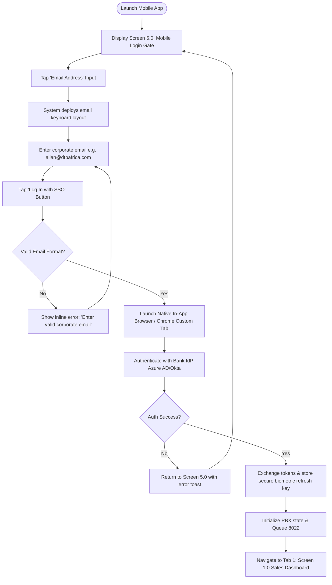
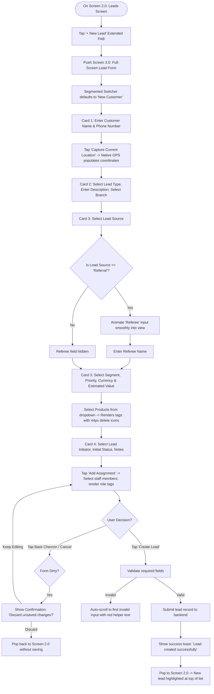
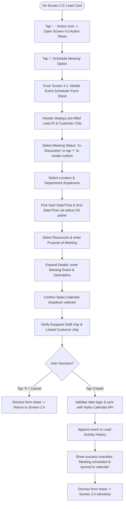

# Mobile-First User Workflows & Interaction Flows: Kati CRM Sales Module

> **Document Version:** 2.0.0  
> **Source Documents:** `reference/sales-module-source.pdf` (`references/mobileApp.pdf`), `design/screen-inventory.md`, `design/screen-mapping.md`, `design/mobile-ux-challenges.md`, `design/ux-architecture.md`  
> **Target Application:** Kati CRM — Enterprise Banking Sales Module (Diamond Trust Bank Africa)  
> **Status:** Mobile Interaction Flows Specification (Mobile-First Redesign)  

---

## 1. Overview & Mobile Interaction Design Principles

This document defines the end-to-end mobile user workflows for the Kati CRM Sales Module. Every workflow translates the desktop interaction patterns documented in the source material into high-efficiency mobile interactions.

### Core Mobile Interaction Principles
1. **Thumb-Driven Execution:** Key action triggers, primary buttons, and confirmation docks are situated within the lower 40% of the screen.
2. **Context Preservation:** Secondary actions (status changes, reassignments) utilize bottom sheets over dimmed backdrops rather than full page navigations, keeping the user oriented in their list context.
3. **Optimized Form Ergonomics:** Long forms are structured with collapsible cards, automatic input focus scrolling, and sticky bottom action bars elevated above the virtual keyboard.
4. **Resilient Data Entry:** Dynamic conditional fields (e.g., `Referee`) animate smoothly into view without causing jarring scroll jumps. Forms implement dirty-state guards to prevent accidental loss of data.
5. **Direct Telephony Integration:** Touchpoints link directly to mobile device native phone dialers, SMS, and WhatsApp apps for field sales representatives.

---

## 2. Mobile Workflow Index

| Workflow ID | Workflow Name | Mobile Containers & Screens | Primary User Role |
|---|---|---|---|
| **MWF-01** | Mobile Authentication & SSO Login | Screen 5.0 (Full-Screen Gate) | All Sales Officers |
| **MWF-02** | Executive Briefing & Mobile Pipeline Review | Screen 1.0 (Tab 1 Root) | Sales Managers, Officers |
| **MWF-03** | Searching, Filtering & Sorting Leads on Mobile | Screen 2.0 (Tab 2 Root) + Filter Sheet | Sales Reps, Collections |
| **MWF-04** | Capturing a Lead for a New Customer | Screen 3.1 (Full-Screen Pushed Form) | Field Sales Officers |
| **MWF-05** | Capturing a Lead for an Existing Customer | Screen 3.2 (Full-Screen Pushed Form) | Relationship Managers |
| **MWF-06** | Auditing Customer 360 Financial Profile | Screens 3.2.1–3.2.4 (Pushed 4-Tab Hub) | Relationship Managers |
| **MWF-07** | Scheduling a Lead Meeting with Calendar Sync | Screens 4.0, 4.1 (Full-Screen Form Sheet) | Sales Reps, RM |
| **MWF-08** | Rapid Pipeline Status Progression | Screens 4.0, 4.2 (Half-Height Bottom Sheet) | Sales Reps, Managers |
| **MWF-09** | Collaborative Lead Reassignment | Screens 4.0, 4.3 (Half-Height Bottom Sheet) | Sales Managers, Supervisors |
| **MWF-10** | Inspecting Lead Details & Historical Audit Stream | Screens 4.0, 4.4.1, 4.4.2 (Pushed 2-Tab View) | Auditors, Sales Reps |
| **MWF-11** | Mobile Lead Export & Email Dispatch | Screens 4.0 (Action Sheet) | Sales Reps, Managers |
| **MWF-12** | Mobile Profile & Organization Settings | Screen 5.1 (Pushed View via Drawer) | System Administrators |

---

## 3. Detailed Step-by-Step Mobile Workflows

---

### MWF-01: Mobile Authentication & SSO Login

* **Goal:** Securely authenticate the mobile sales officer into Kati CRM using corporate Single Sign-On (SSO) with mobile keyboard optimization.
* **Actor:** Field Sales Representative, Relationship Manager.
* **Source Screen:** Screen 5.0 (Login Page).



#### Detailed Steps:
1. **Launch:** User opens the Kati mobile application or navigates to the PWA URL.
2. **Presentation:** Screen 5.0 renders with the Kati CRM brand identity, DTB logo, and a clean mobile login card.
3. **Input:** User taps the `Email Address` input. The OS opens an email-optimized keyboard (`type="email"` with `@` and `.com` shortcuts).
4. **Submission:** User taps the large 52px magenta `Log In with SSO` button.
5. **SSO Flow:** The app opens an In-App Browser (ASWebAuthenticationSession on iOS / Chrome Custom Tabs on Android) to complete enterprise MFA/biometric authentication.
6. **Initialization:** Upon successful token receipt, the app securely stores session tokens, activates telephony queue `8022`, sets agent presence to `Online`, and lands on **Tab 1: Screen 1.0 (Sales Dashboard)**.

---

### MWF-02: Executive Briefing & Mobile Pipeline Review

* **Goal:** Review daily sales performance, inspect the 6 pipeline stages, and examine conversion charts on a smartphone viewport.
* **Actor:** Sales Representative, Sales Manager.
* **Source Screen:** Screen 1.0 (Sales Dashboard).

```mermaid
flowchart TD
    A([Land on Tab 1: Dashboard]) --> B[Render Top 8 KPI Summary Strip as 2x4 Grid]
    B --> C[User scrolls down to 'Lead Pipeline' Section]
    C --> D[View Horizontal Scrollable Pipeline Funnel Cards]
    D --> E{Tap a Pipeline Stage e.g. 'Warm (KES 4.5M)'?}
    E -- Yes --> F[Direct filter transition to Tab 2: Leads filtered by 'Warm']
    E -- No --> G[User scrolls to Analytics Charts]
    G --> H[View Lead Conversion Trend Line Chart with touch scrub tooltips]
    H --> I[View Product Interest Donut Chart with tap-to-expand legend]
    I --> J{User taps '+ New Lead' FAB?}
    J -- Yes --> K[Push Screen 3.0 Lead Capture Router]
    J -- No --> L[Tap Bottom Nav 'Leads' Tab -> Navigate to Screen 2.0]
```

#### Detailed Steps:
1. **Entry:** User views Screen 1.0 (Dashboard).
2. **KPI Review:** The 8 performance cards are formatted as a responsive **2-column x 4-row grid** (or a horizontal swipe carousel), displaying key counters: `Follow-Ups Today (0)`, `Meetings Today (0)`, `Open Engagements (5)`, `Total Leads (11)`, `Hot (1)`, `Warm (3)`, `Cold (2)`, `Converted (2)`.
3. **Pipeline Funnel:** The 6 desktop Kanban columns are transformed into a **Horizontal Swipe Funnel** with clear stage indicators: `New`, `Cold`, `Warm`, `Hot`, `Nurturing`, `Converted`. Each stage displays lead count, total value (`KES`), and top lead cards.
4. **Interactive Stage Drilldown:** Tapping any pipeline stage card immediately navigates to Tab 2 (`Leads`) pre-filtered to that specific stage.
5. **Chart Interaction:**
   - The *Lead Conversion Trend* line chart features touch-scrubbing: dragging a finger along the line displays exact date and lead conversion values in a floating tooltip.
   - The *Product Interest Distribution* donut chart provides a touchable color-coded legend; tapping a segment highlights its percentage share.
6. **Action:** The persistent `+ New Lead` FAB is available at the bottom-right for immediate lead intake.

---

### MWF-03: Searching, Filtering & Sorting Leads on Mobile

* **Goal:** Quickly find, segment, and organize lead records on mobile without losing screen context.
* **Actor:** Sales Representative, Collections Officer.
* **Source Screen:** Screen 2.0 (All Leads Table).

```mermaid
flowchart TD
    A([On Tab 2: Leads Screen]) --> B[Review Top 7 Status KPI Scrollable Chips]
    B --> C{Search or Filter?}
    
    C -- "Search" --> D[Tap Sticky Search Bar]
    D --> E[Type query e.g. 'Zamzam' or '0703133']
    E --> F[Debounced search 300ms dynamically filters Lead Cards]
    F --> G[Tap '✕' on search bar to clear query]
    
    C -- "Quick Status Filter" --> H[Tap Status Chip e.g. 'Warm (4)']
    H --> I[Lead Card Stream instantly updates to Warm leads only]
    
    C -- "Advanced Filter" --> J[Tap 'Filters ⏷' Button]
    J --> K[Slide up Screen Multi-Attribute Filter Bottom Sheet]
    K --> L[Select Status, Segment, Priority chips]
    L --> M[Pick Branch & Assignee from searchable pickers]
    M --> N[Set Date Range using native calendar sheet]
    N --> O[Tap 'Apply Filters (X Leads Found)']
    O --> P[Filter sheet closes; active filter count badge updates]
    
    C -- "Sort" --> Q[Tap '⇅ Sort' Button]
    Q --> R[Slide up Sort Bottom Sheet -> Select 'Value: High to Low']
    R --> S[List re-orders immediately]
```

#### Detailed Steps:
1. **Entry:** User taps `Leads` on the bottom navigation bar (Screen 2.0).
2. **List Presentation:** The 14-column desktop table is transformed into a vertical stream of **Rich Lead Cards**. Each card prominently displays:
   - Header: Customer Name (`ZAMZAM HASSAN MOHAMED`), Lead ID (`L-2026-000184`), and color-coded Status badge (`Warm`).
   - Body: Phone number (clickable `tel:` link), Branch (`Griffindor`), Customer Segment (`Retail`), Estimated Value (`KES 6,666`), and Priority badge (`Low`).
   - Footer: Assigned Officers chips, Product tags, and 48px Action Ellipsis button (`⋯`).
3. **Quick Search:** Tapping the sticky search bar deploys the keyboard. Real-time debounced search (300ms) narrows down cards instantly.
4. **Horizontal Fast Filter:** User can single-tap horizontal status chips (`All`, `Hot`, `Warm`, `Cold`, `Nurturing`, `Converted`, `Lost`) directly below the search bar.
5. **Advanced Filter Bottom Sheet:**
   - Tapping `[ Filters ⏷ ]` opens the 85% height bottom sheet.
   - User configures criteria using multi-select chips and searchable pickers.
   - The sticky footer button displays `Apply Filters (X Leads Found)`, giving instant feedback on query matches before dismissing.
6. **Sorting:** Tapping `[ ⇅ Sort ]` opens a compact sheet to order leads by Date, Value, Priority, or Name.

---

### MWF-04: Capturing a Lead for a New Customer

* **Goal:** Capture a brand-new banking prospect in the field with automatic GPS geolocation capture and smooth conditional form fields.
* **Actor:** Field Sales Representative.
* **Source Screens:** Screens 2.0, 3.1 (Capture Lead: New Customer).



#### Detailed Steps:
1. **Trigger:** User taps the `+ New Lead` FAB from Dashboard or Leads screen.
2. **Form Architecture:** Screen 3.1 opens as a **Full-Screen Pushed View** with a sticky top app bar and a sticky bottom action dock.
3. **Card 1 — Customer Profile:**
   - `Customer Name *`: Text input.
   - `Phone Number *`: Phone keypad (`type="tel"`).
   - `Physical Location`: Text input with a prominent `[ 📍 Detect GPS Location ]` button that queries device location services and populates city/address coordinates.
4. **Card 2 — Lead Information:**
   - `Lead Type *`: Selector (`New Lead`).
   - `Description *`: Multi-line text area.
   - `Branch Name *`: Searchable bottom sheet picker (e.g., `Ravenclaw`, `Courtyard`).
5. **Card 3 — Lead Details & Conditional Logic:**
   - `Lead Source *`: Dropdown (e.g., `Referral`).
   - **Conditional Referee:** If `Referral` is selected, the `Referee *` text input animates into view smoothly without layout jarring. User inputs referee name.
   - `Customer Segment *` (`Retail`, `Corporate`, `Business`) & `Lead Priority *` (`High`, `Medium`, `Low`): Touch-friendly segmented chips.
   - `Estimated Value *`: Numeric keypad with Currency selector (`USD`, `KES`).
   - `Product Type *`: Multi-select picker. Added products render as distinct tags with 44px trash icons (`🗑`).
6. **Card 4 — Assignment & Remarks:**
   - `Lead Initiator *` (pre-filled with current user), `Lead Status *` (`New`), and `Comments / Notes`.
   - `Add Assignment`: Searchable team picker. Selected assignees appear with system role tags (e.g., `NellyM [Collections Manager] [✕]`).
7. **Submission & Guardrails:**
   - Sticky bottom dock displays `[ Cancel ]` and `[ Create Lead ]`.
   - If user attempts to leave with dirty fields, an alert dialog guards against accidental loss.
   - Tapping `Create Lead` validates inputs, submits the record, and pops back to Screen 2.0 where the new card appears with a brief highlight animation.

---

### MWF-05: Capturing a Lead for an Existing Customer (Cross-Sell)

* **Goal:** Seamlessly search the Core Banking System (CBS), auto-populate customer metadata, provide direct access to Customer 360, and submit a cross-sell lead.
* **Actor:** Relationship Manager.
* **Source Screens:** Screens 2.0, 3.2 (Capture Lead: Existing Customer).

```mermaid
flowchart TD
    A([On Screen 3.0 Lead Form]) --> B[Tap '(●) Existing Customer' Segmented Toggle]
    B --> C[Card 1 morphs to Live CBS Customer Search]
    C --> D[Tap 'Search Customer *' field -> Type 'Mateen']
    D --> E[Dropdown displays live matching records with CIF & Email]
    E --> F[Select 'Mateen Premji']
    
    F --> G[System pre-fills Full Name, Phone, CIF, Location]
    G --> H[Render Customer Summary Card with prominent '[ View Customer 360 ]' button]
    
    H --> I{User wants to audit holdings first?}
    I -- Yes --> J[Tap '[ View Customer 360 ]' button]
    J --> K[Push MWF-06: Customer 360 Hub]
    K --> L[Audit accounts, cards, policies -> Tap Back Chevron (←)]
    L --> H
    
    I -- No --> M[Complete Card 2: Description & Branch]
    M --> N[Complete Card 3: Target Products e.g. World Credit Card & Value]
    N --> O[Complete Card 4: Status & Assigned Team]
    O --> P[Tap 'Create Lead' Sticky Button]
    P --> Q[Lead saved & linked to Customer CIF -> Pop to Screen 2.0]
```

#### Detailed Steps:
1. **Mode Switch:** On the Lead Capture form, user taps the `(●) Existing Customer` option on the top segmented control.
2. **Search Activation:** Card 1 morphs to display a `Search Customer *` input with a search icon.
3. **Live Lookup:** User types customer name or CIF (e.g., `Mateen`). A floating results sheet displays matches with Name, CIF, and Email.
4. **Data Hydration:** Upon selecting `Mateen Premji`:
   - Customer details auto-populate in read-only styled cards.
   - **Architectural Solution to Hidden Entry Point:** The customer card prominently displays an explicit **`[ View Customer 360 ↗ ]`** button, completely resolving the source desktop flaw where this was buried inside a collapsed sidebar.
5. **Holdings Audit (Optional):** If the RM needs to inspect existing accounts, they tap `[ View Customer 360 ↗ ]` (branches into **MWF-06**). Returning via back chevron restores all form state.
6. **Product & Value Capture:** RM selects cross-sell target products (`World Credit Card`), sets Estimated Value (`KES 2,000,000`), configures assignees, and taps `Create Lead`.

---

### MWF-06: Auditing Customer 360 Financial Profile

* **Goal:** Perform an in-depth relationship and financial audit of an existing customer across accounts, mobile banking PINs, insurance, and credit cards.
* **Actor:** Relationship Manager, Branch Officer.
* **Source Screens:** Screens 3.2, 3.2.1, 3.2.2, 3.2.3, 3.2.4.

```mermaid
flowchart TD
    A([Trigger: Tap 'View Customer 360' from Form or Lead Detail]) --> B[Push Screen 3.2.1: Customer 360 Hub]
    B --> C[View Master Biodata Header: CIF, ID, Multi-Phones, Omnichannel Dock]
    
    C --> D[Horizontal Segmented Tab Bar: Select Banking Facet]
    
    D -- "Tab 1: Accounts" --> E[View Core Banking Account Cards with Co-Owners & Branch Codes]
    E --> F[Tap specific Account Card -> In-place expansion of active Product Checklist]
    F --> G[Tap '+ Add to Task' button to initiate follow-up]
    
    D -- "Tab 2: Mobile Banking" --> H[Load Screen 3.2.2: Mobile Profile Cards]
    H --> I[Audit 12 mobile records: verify 'Active PIN' vs 'One Time PIN']
    
    D -- "Tab 3: Bancassurance" --> J[Load Screen 3.2.3: Policy Portfolio Cards]
    J --> K[Inspect General & Life policy numbers, insurers & expiry dates]
    
    D -- "Tab 4: Credit Cards" --> L[Load Screen 3.2.4: Credit Card Cards]
    L --> M[Inspect masked PANs, replacement status & KES 2,000,000 limits]
    
    D -- "Compliance & History" --> N[Scroll down to collapsible DTB Compliance & Activity History]
    N --> O[Filter touchpoints: All / Tickets / Leads / Orders / Events]
    
    O --> P[Tap Back Chevron (←) -> Pop back to Lead Capture or Leads List]
```

#### Detailed Steps:
1. **Entry:** RM taps `[ View Customer 360 ]` from Screen 3.2 or Lead Details.
2. **Master Biodata Header:**
   - Displays customer avatar, name (`MATEEN PREMJI`), CIF (`837649`), National ID (`36930306`), and verified badge.
   - Includes horizontal omnichannel action dock: direct call (`tel:`), SMS, and WhatsApp shortcuts.
3. **Facet Navigation via Segmented Tabs:**
   - Directly below the profile header, a horizontal scrollable tab bar allows instant switching between:
     `[ 🏦 Accounts (3) ]   [ 📱 Mobile Banking (12) ]   [ 🛡️ Bancassurance (2) ]   [ 💳 Credit Cards (2) ]`
4. **Tab 1: Accounts (`Screen 3.2.1`):**
   - Renders 3 account cards (`Salary Account`, `Current Account`, `Savings Account`).
   - Displays branch routing (`Courtyard Branch 041`), joint co-owners, and `+ Add to Task`.
   - **Causality Fix:** Tapping an account card expands the active product checklist *directly inside that account card*, eliminating the desktop disconnect where changes happened off-screen.
5. **Tab 2: Mobile Banking (`Screen 3.2.2`):**
   - Replaces the dense 12-row desktop table with clean mobile profile cards showing registered MSISDN, branch code (`041`), and high-visibility PIN status badges (`Active PIN` [Green] vs `One Time PIN` [Amber]).
6. **Tab 3: Bancassurance (`Screen 3.2.3`):**
   - Policy cards categorized with `GENERAL` and `LIFE` badges, policy numbers, and renewal dates.
7. **Tab 4: Credit Card (`Screen 3.2.4`):**
   - Card facility cards displaying masked PAN (`524406XXXXXX7240`), status (`Replaced` vs `Normal`), and credit limits (`KES 2,000,000`).
8. **Compliance & History:**
   - Bottom section features a collapsible `DTB Compliance` accordion and an `Activity History` feed with filter pills (`All`, `Tickets`, `Leads`, `Orders`).

---

### MWF-07: Scheduling a Lead Meeting with Calendar Sync

* **Goal:** Schedule a customer meeting, reserve conference resources, and synchronize with Nylas Calendar from mobile.
* **Actor:** Sales Representative, Relationship Manager.
* **Source Screens:** Screens 2.0, 4.0, 4.1 (Schedule Lead Meeting).



#### Detailed Steps:
1. **Trigger:** Tapping `⋯` on any lead card opens the **Screen 4.0 Lead Action Bottom Sheet**. User selects `📅 Schedule Meeting`.
2. **Form Sheet Container:** Screen 4.1 opens as a dedicated **Full-Screen Form Sheet** with a top close button (`✕`) and sticky `Create` button at the bottom.
3. **Context Display:** Pre-fills `Lead ID: L-2026-000184` and `Customer: ZAMZAM HASSAN MOHAMED`.
4. **Configuration:**
   - Meeting Status: Dropdown with inline `(+)` button for adding custom status.
   - Date & Time: Tapping Start/End dates deploys native OS mobile wheel/calendar pickers.
   - Department, Resources, and Purpose text field.
   - Nylas Calendar sync verification, Staff chip, and Customer link chip.
5. **Execution:** User taps solid orange `Create` button. Event is synced to Nylas Calendar, written to the lead's audit log, and sheet dismisses.

---

### MWF-08: Rapid Pipeline Status Progression

* **Goal:** Update a lead's qualification status (e.g., `Warm → Nurturing`) and capture transition audit notes in under 5 seconds.
* **Actor:** Sales Representative, Sales Manager.
* **Source Screens:** Screens 2.0, 4.0, 4.2 (Update Status Pop-up).

```mermaid
flowchart TD
    A([On Screen 2.0: Lead Card]) --> B{Trigger Mechanism?}
    B -- "Option A: Gesture" --> C[Swipe Lead Card left -> Tap 'Status' button]
    B -- "Option B: Action Menu" --> D[Tap '⋯' -> Select '🔄 Update Status']
    
    C --> E[Open Screen 4.2: Half-Height Status Bottom Sheet]
    D --> E
    
    E --> F[Header displays Lead ID & Customer Name read-only chips]
    F --> G[Select new status from visual chips: Warm / Hot / Nurturing / Converted / Lost]
    G --> H[Enter audit justification in 'Comments (Optional)' text area]
    
    H --> I{Tap Action?}
    I -- "Cancel / Swipe Down" --> J[Dismiss bottom sheet without changes]
    I -- "Tap 'Update Status'" --> K[Commit new status to database]
    K --> L[Append event to Activity Log with actor stamp & comments]
    L --> M[Update status pill color on Lead Card instantly]
    M --> N[Show toast: 'Status updated to Nurturing' -> Sheet closes]
```

#### Detailed Steps:
1. **Trigger:** User swipes a lead card to the left and taps the blue `Status` button, or selects `Update Status` from the action menu.
2. **Bottom Sheet:** Screen 4.2 opens as a **Half-Height Bottom Sheet** over the dimmed leads list.
3. **Context:** Read-only chips display Lead ID (`L-2026-000184`) and Customer (`ZAMZAM HASSAN MOHAMED`).
4. **Selection:** The desktop dropdown is replaced with **color-coded status chips** (`New`, `Cold`, `Warm`, `Hot`, `Nurturing`, `Converted`, `Lost`) allowing 1-tap selection.
5. **Comments:** User enters optional transition notes (e.g., `Customer confirmed interest in salary account`).
6. **Submission:** User taps the full-width orange `Update Status` button. Sheet dismisses, status pill updates on the card, and change is logged.

---

### MWF-09: Collaborative Lead Reassignment

* **Goal:** Adjust collaborative team assignees, delete officers, and assign specialists with full audit accountability.
* **Actor:** Sales Manager, Supervisor.
* **Source Screens:** Screens 2.0, 4.0, 4.3 (Reassign Lead Pop-up).

```mermaid
flowchart TD
    A([On Screen 2.0: Lead Card]) --> B[Tap '⋯' Action Menu -> Select '👥 Reassign Lead']
    B --> C[Open Screen 4.3: Half-Height Reassignment Bottom Sheet]
    C --> D[Header displays Lead ID context]
    
    D --> E[View active assignees list: each showing Name, Role badge & 44px '✕']
    E --> F{Modify Assignees?}
    
    F -- "Remove Officer" --> G[Tap '✕' delete button on assignee chip]
    G --> H[Officer chip removed from active list]
    
    F -- "Add Officer" --> I[Tap 'Add Assignment' searchable user picker]
    I --> J[Search & select staff member e.g. Derrick Ombaki]
    J --> K[New officer chip added with role badge '[Administrator]']
    
    H --> L[Enter handover rationale in 'Comments (Optional)']
    K --> L
    
    L --> M{Tap Action?}
    M -- "Cancel / Swipe Down" --> N[Dismiss sheet without committing changes]
    M -- "Tap 'Update Assignment'" --> O[Save updated assignment roster to lead]
    O --> P[Append reassignment event to Activity Log]
    P --> Q[Refresh 'Assigned To' chips on Lead Card]
    Q --> R[Show toast: 'Lead reassigned successfully' -> Sheet closes]
```

#### Detailed Steps:
1. **Trigger:** User selects `👥 Reassign Lead` from Screen 4.0 action sheet.
2. **Bottom Sheet:** Screen 4.3 opens as a **Half-Height Bottom Sheet**.
3. **Roster Audit:** Active assignees render as distinct cards/chips:
   - `Calendar event` `[Administrator]` `[✕]`
   - `Branson Allann` `[Relationship Manager]` `[✕]`
4. **Modifications:**
   - Tapping the prominent 44px `✕` target removes an officer.
   - Tapping `Add Assignment` deploys a searchable user picker to add cross-functional colleagues.
5. **Handover Notes:** User inputs context into `Comments (Optional)` (e.g., `Transferred to Corporate RM for account opening`).
6. **Submission:** User taps `Update Assignment`. Record updates, audit event logs, and sheet closes.

---

### MWF-10: Inspecting Lead Details & Historical Audit Stream

* **Goal:** Perform a complete inspection of lead attributes and review its chronological lifecycle history.
* **Actor:** Sales Representative, Auditor, Supervisor.
* **Source Screens:** Screens 2.0, 4.0, 4.4.1, 4.4.2 (Lead Details & Activity Log).

```mermaid
flowchart TD
    A([On Screen 2.0: Leads List]) --> B{Inspection Trigger?}
    B -- "Direct Tap" --> C[Tap anywhere on Lead Card body]
    B -- "Action Menu" --> D[Tap '⋯' -> Select '👁️ View Details']
    
    C --> E[Push Screen 4.4: Full-Screen Lead Details View]
    D --> E
    
    E --> F[Render Hero Card: Customer, ID, Status, Value, Direct Call/Chat dock]
    F --> G[Top Segmented Control: '[ Profile ]' active by default]
    
    G --> H[Inspect single-column grouped attribute cards: Specs, Commercial, Assignment]
    
    H --> I{Switch to Audit Trail?}
    I -- Yes --> J[Tap '[ Activity Log ]' Segmented Tab]
    J --> K[View Screen 4.4.2: Chronological Timeline Stream]
    K --> L[Audit timeline nodes: Status transitions, Timestamps, Actor stamps, Notes]
    L --> I
    
    I -- No / Take Action --> M{Next Step?}
    M -- "Tap Action Dock" --> N[Tap 'Update Status', 'Reassign', or 'Schedule Meeting']
    N --> O[Launches respective bottom sheet / form]
    
    M -- "Tap Back Chevron (←)" --> P[Pop view -> Return to Screen 2.0 Leads List]
```

#### Detailed Steps:
1. **Trigger:** User taps directly on a lead card or selects `View Details` from the action menu.
2. **Container:** Screen 4.4 opens as a **Dedicated Full-Screen View** (eliminating the desktop cramped modal).
3. **Hero Header Card:**
   - Displays Customer Name, Lead ID, Status badge, Estimated Value, and quick contact buttons (`Call`, `SMS`, `WhatsApp`).
4. **Segmented Navigation:**
   - Pinned below the hero card: `[ Profile / Overview ]   [ Activity Log ]`.
5. **Profile View (`Screen 4.4.1`):**
   - Renders clean single-column cards:
     - *Customer & Contact:* Full Name, Phone, Address.
     - *Lead Specifications:* Lead Type, Source, Referee, Branch, Description.
     - *Commercial Terms:* Customer Segment, Priority, Estimated Value, Product Interests tags.
     - *Assignment & Internal Notes:* Lead Initiator, Assigned Officers with role tags, Notes.
6. **Activity Log View (`Screen 4.4.2`):**
   - Chronological vertical timeline stream with connected nodes.
   - Each card displays timestamp, relative time ("3 hours ago"), actor stamp (`Branson Allann`), action taken (`Status updated from Warm to Nurturing`), and user comments.
7. **Action Dock:** Persistent bottom bar provides 1-tap triggers: `[ Update Status ]`, `[ Reassign ]`, `[ Schedule Meeting ]`.

---

### MWF-11: Mobile Lead Export & Email Dispatch

* **Goal:** Generate a PDF report of a lead or dispatch it via email directly from mobile.
* **Actor:** Sales Representative, Sales Manager.
* **Source Screens:** Screens 2.0, 4.0.

#### Detailed Steps:
1. On Screen 2.0, user taps `⋯` on target lead card to open Screen 4.0 Action Sheet.
2. **Option A — Export as PDF:**
   - User taps `📄 Export as PDF`.
   - The app compiles the PDF and opens the native mobile share sheet (iOS Share Sheet / Android Intent), allowing the user to save to device files, print, or AirDrop.
3. **Option B — Export via Email:**
   - User taps `✉️ Export as PDF via Email`.
   - The app triggers the backend email dispatcher, closes the action sheet, and displays a confirmation toast: *"PDF report dispatched to branson@dtbafrica.com"*.

---

### MWF-12: Managing Mobile Profile & Organization Settings

* **Goal:** View company settings, copy enterprise API keys, manage 2FA, and update personal employee profile on mobile.
* **Actor:** System Administrator, Enterprise User.
* **Source Screens:** Global App Drawer, Screen 5.1 (Company Details / User Profile).

#### Detailed Steps:
1. User taps the `☰` hamburger icon on the top app bar to open the Global App Drawer.
2. User selects `⚙️ Settings & Profile` at the bottom of the drawer.
3. **Screen 5.1** opens as a full-screen view with collapsible sections:
   - *Company Details:* Corporate Name, Address, Currency (`KES`), and `API Key` with a 1-tap `[ Copy Key ]` button.
   - *Taxes Configuration:* Table of active tax rates with `+ Add New Tax` button.
   - *Security & 2FA:* Device 2FA enrollment status (`Add Second Step`) and `Change Password` modal.
   - *Employee Personal Profile:* Profile photo upload via mobile camera/gallery, First/Last Name, Employer Phone, and WhatsApp ID.
4. Tapping the back chevron (`←`) returns the user to their active workspace.

---

## 4. Summary of Mobile Ergonomic Enhancements

| Source Desktop Workflow | Desktop Pain Point | Mobile Architectural Enhancement |
|---|---|---|
| **WF-03: Filtering** | 9 stacked filter controls push data 900px off-screen | Dual-tier filtering: instant horizontal chips + 85% height bottom sheet with live count |
| **WF-04 & 05: Lead Capture** | Sticky right jump rail unusable; virtual keyboard obscures fields | Full-screen form with smooth collapsible cards and sticky bottom action dock |
| **WF-05: Existing Customer** | Customer 360 entry point hidden inside collapsed sidebar avatar | Explicit, prominent `[ View Customer 360 ↗ ]` button rendered directly on customer card |
| **WF-06: Customer 360** | Radio buttons used as navigation; cause-and-effect disconnect on accounts | Horizontal segmented chip tabs; dynamic active products expand *inside* account cards |
| **WF-08: Status Updates** | Centered modal over dark backdrop causes nested scroll | Half-height bottom sheet with large 1-tap status chips, dismissible via swipe down |
| **WF-10: Lead Details** | Cramped 2-column modal squishes text | Full-screen view with hero card, direct contact dock, and segmented Profile/Timeline tabs |

---

## 5. Conclusion

The Kati CRM Mobile Workflows establish an intuitive, thumb-zone-optimized operational framework. By converting dense desktop tables and modal dialogs into native mobile cards, bottom sheets, and full-screen forms, enterprise banking officers can execute critical daily workflows with maximum speed and zero friction in the field.
