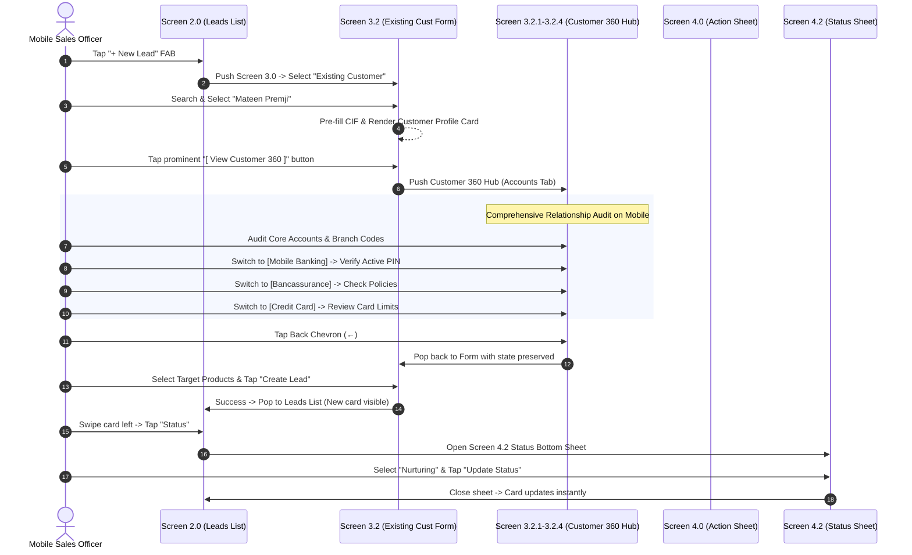

# Mobile UX Architecture & Information Hierarchy: Kati Enterprise Sales Module

> **Document Version:** 2.0.0  
> **Source Documents:** `reference/sales-module-source.pdf` (`references/mobileApp.pdf`), `design/screen-inventory.md`, `design/screen-mapping.md`, `design/mobile-ux-challenges.md`  
> **Target Application:** Kati CRM — Enterprise Banking Sales Module (Diamond Trust Bank Africa)  
> **Status:** Mobile UX Architecture Specification (Mobile-First Redesign)  

---

## 1. Executive Summary & Mobile Transformation Philosophy

The Kati Enterprise Sales Module is a critical operational system for Diamond Trust Bank (DTB) Africa, powering commercial lead acquisition, customer cross-selling, pipeline progression, meeting scheduling, 360-degree financial relationship auditing, and regulatory compliance.

The legacy desktop system is characterized by extreme visual and data density:
* An 18-module persistent left sidebar
* A 6-tab secondary horizontal sub-navigation bar
* An ultra-dense 14-column master data table
* A 6-stage side-by-side Kanban pipeline board
* A 3-tier split-pane Customer 360 relationship cockpit
* Centered desktop modal dialogs with nested scrolling

This document defines the **Mobile UX Architecture** that transforms this desktop-centric system into a responsive, thumb-optimized, high-velocity mobile experience. 

### Core Transformation Philosophy
1. **Zero Functional Degradation:** Every single data attribute, business validation rule, workflow step, and audit mechanism present in the 16 source screens is preserved without loss or arbitrary simplification.
2. **Thumb-Zone Optimization:** High-frequency actions (navigation, lead capture, status updates, phone calls) are anchored within the ergonomic primary thumb zone (bottom 40% of the viewport).
3. **Progressive Disclosure:** Dense multi-attribute records are decomposed into clean, hierarchically layered cards and segmented views rather than unreadable 14-column horizontal scroll tables.
4. **Decoupled Overlays:** Centered desktop modals are replaced with native mobile bottom sheets and dedicated full-screen forms with sticky action bars that dynamically accommodate virtual keyboards.
5. **Direct Architectural Pathways:** The documented source flaw—where Customer 360 was hidden behind an avatar in a collapsed sidebar—is eliminated through prominent, contextual direct-access controls.

---

## 2. Definitive Information Architecture (14 Core Dimensions)

The mobile information architecture is structured across 14 foundational architectural dimensions:

```
                                  [ 5.0 Login / SSO ]
                                           │
                                           ▼
                      ┌─────────────────────────────────────────┐
                      │        GLOBAL APPLICATION SHELL         │
                      │  [☰ 18 Modules]   [Queue/PBX]   [Profile]│
                      └────────────────────┬────────────────────┘
                                           │
         ┌─────────────────────────────────┴─────────────────────────────────┐
         ▼                                 ▼                                 ▼
┌──────────────────┐             ┌──────────────────┐             ┌──────────────────┐
│ 1.0 SALES DASH   │             │ 2.0 LEADS HUB    │             │ ENGAGEMENTS &    │
│ - 8 KPI Metrics  │             │ - 7 Status KPIs  │             │ MORE HUBS        │
│ - Pipeline Stages│             │ - Search & Filter│             │ - Customer Eng   │
│ - Trend Charts   │             │ - Lead Cards     │             │ - Collections    │
└──────────────────┘             └─────────┬────────┘             │ - Reports        │
                                           │                      └──────────────────┘
                 ┌─────────────────────────┼─────────────────────────┐
                 ▼                         ▼                         ▼
       ┌──────────────────┐      ┌──────────────────┐      ┌──────────────────┐
       │ CREATE FLOW      │      │ CONTEXT ACTIONS  │      │ DETAIL FLOW      │
       │ 3.1 New Customer │      │ 4.0 Action Sheet │      │ 4.4.1 Profile Tab│
       │ 3.2 Exist Cust   │      │ 4.1 Meeting Form │      │ 4.4.2 Log Tab    │
       │      │           │      │ 4.2 Status Sheet │      └──────────────────┘
       │      ▼           │      │ 4.3 Reassign     │
       │ 3.2.1-4 Cust 360 │      └──────────────────┘
       └──────────────────┘
```

---

### Dimension 1: Primary Application Navigation (Global Shell)
* **Desktop Baseline:** Persistent vertical left drawer containing 18 discrete CRM modules.
* **Mobile Architecture:** **Modal Enterprise App Launcher Drawer**.
  - Accessible from every top-level view via the top-left hamburger icon (`☰`).
  - Opens as an 85% width drawer with backdrop dimming scrim.
  - Groups the 18 modules into 4 functional operational domains:
    1. *Sales & Core Banking:* Sales (active), Contacts (Customer 360), Opportunity, Orders, B2B Commercial.
    2. *Service & Branch Support:* Helpdesk, Social Media, Branch Complaints, Branch Feedback, Customer Feedback (CSAT).
    3. *Outreach & Telephony:* Call Reports, Outbound, Queue Management, Campaign, Calendar.
    4. *Governance & Intelligence:* Analytics, Quality Assurance, Knowledge Base.
  - Houses the global tenant header, active agent profile, telephony queue status (`8022`), PBX softphone toggle, and Logout trigger.

---

### Dimension 2: Sales Module Navigation
* **Desktop Baseline:** Horizontal 6-tab secondary sub-nav strip running beneath the top header (`Dashboard`, `All Leads`, `Customer Engagement`, `All Engagements`, `Collections`, `Report & Analytics`).
* **Mobile Architecture:** **4-Destination Persistent Bottom Navigation Bar**.
  - **Height:** 64px, anchored above OS gesture navigation bar with safe-area padding.
  - **Destination 1 — Dashboard (`Screen 1.0`):** Daily executive briefing, 8 performance counters, pipeline funnel, conversion trends, product donuts.
  - **Destination 2 — Leads (`Screen 2.0`):** Core operational execution engine, lead card stream, search, filtering, and creation FAB.
  - **Destination 3 — Engagements (`Submodules 3.3 & 3.4`):** Unified engagement center with segmented sub-nav.
  - **Destination 4 — More (`Submodules 3.5 & 3.6` + Settings):** Hub for Collections, Sales Reports & Analytics, and User Profile / Company Details (`Screen 5.1`).

---

### Dimension 3: Submodule Navigation
To prevent horizontal tab truncation while providing instant access to all 6 submodules:
1. **Dashboard (`1.0`):** Direct Bottom Nav Destination 1.
2. **All Leads (`2.0`):** Direct Bottom Nav Destination 2.
3. **Customer Engagement & All Engagements (`3.3 & 3.4`):** Unified inside Bottom Nav Destination 3 (`Engagements`) via a top **Segmented Control Pill Switcher**:
   - `[ Customer Engagements ]  [ All Interactions ]`
4. **Collections (`3.5`) & Report & Analytics (`3.6`):** Positioned at the top of Destination 4 (`More`), providing clean, card-based navigation to arrears workflows and detailed conversion metrics.

---

### Dimension 4: Contextual Navigation
Replaces desktop row hover states and anchored dropdown menus:
1. **Card Action Sheet (`Screen 4.0`):** Tapping the explicit 48px action icon (`⋯`) or long-pressing any lead card opens a **Modal Bottom Sheet** exposing all 6 lead workflow actions.
2. **Swipe-Based Quick Actions:**
   - *Swipe Right:* Direct telephony trigger (launches device phone dialer with customer MSISDN pre-loaded).
   - *Swipe Left:* Reveals fast-action shortcut buttons (`Update Status` and `Schedule Meeting`).
3. **Customer 360 Direct Link:** Tapping any customer name or avatar from the Leads list, Lead Details, or Existing Customer form navigates directly to the Customer 360 relationship view.

---

### Dimension 5: Screen Hierarchy
The application is structured into four strict hierarchical tiers:

| Tier | Lifecycle & Container | Screens | Navigation Mechanism |
|---|---|---|---|
| **Tier 0: Auth Gate** | Full-Screen Unauthenticated | Screen 5.0 (SSO Login) | Replaces app root upon logout or session expiry. |
| **Tier 1: Module Roots** | Persistent Bottom Nav Shell | Screens 1.0, 2.0, Engagements, More | Direct tab switching; preserves internal scroll state. |
| **Tier 2: Transactional Pushed Views** | Full-Screen `Scaffold` Push | Screens 3.1, 3.2, 3.2.1–3.2.4, 4.1, 4.4.1, 4.4.2, 5.1 | Pushed onto current tab stack; top-left chevron (`←`) back button. |
| **Tier 3: Contextual Action Overlays** | Native `ModalBottomSheet` | Screens 4.0, 4.2, 4.3, Filter Sheet, Sort Sheet | Slides up over current view; swipe down or tap backdrop to dismiss. |

---

### Dimension 6: Back Navigation
To guarantee predictability and eliminate "trapped state" errors:
1. **Stack Hierarchy (Tier 2 Views):**
   - Top-left header displays a standard back chevron (`←`).
   - Native OS gestures (iOS edge-swipe, Android back swipe) pop the current screen from the stack.
   - **Form Dirty Checking:** Any modified form (`Screen 3.1`, `3.2`, `4.1`) prompts: *"Discard unsaved changes?"* (`[ Keep Editing ]` / `[ Discard ]`) before popping the stack.
2. **Bottom Navigation Roots (Tier 1 Views):**
   - Pressing the hardware/system back button from Tabs 2, 3, or 4 navigates back to Tab 1 (`Dashboard`).
   - Pressing back from Tab 1 triggers a confirmation snackbar: *"Press back again to exit Kati CRM"*.
3. **Bottom Sheets (Tier 3 Views):**
   - Dismissible by downward swipe on drag handle, backdrop tap, or `✕` close button without altering the route stack.

---

### Dimension 7: Search Mechanics
* **Location & Persistence:** Prominently embedded as a sticky search bar at the top of Screen 2.0 (`All Leads`).
* **Interaction Flow:**
  1. User taps search bar (`Search by Customer, Lead ID, Phone, Branch...`).
  2. Input elevates, and recent search history tags (`Recent: Zamzam, KES 1M+, Courtyard`) appear below.
  3. Real-time debounced search (300ms) filters lead cards dynamically.
  4. Active query reveals an instant clear button (`✕`).
* **Global Search:** Accessible via the magnifying glass icon in the top app bar across all screens, querying across leads, contacts, and tickets.

---

### Dimension 8: Filtering Mechanics
Eliminates the desktop filter panel that pushed data 900px off-screen:
1. **Tier A: Fast-Filter Scrollable Chips (In-View):**
   - Pinned directly under the search bar on Screen 2.0.
   - Horizontal scrollable chips: `[ All (36) ]  [ Hot (1) ]  [ Warm (4) ]  [ Cold (4) ]  [ Nurturing (1) ]  [ Converted (4) ]  [ Lost (3) ]`.
   - Single tap filters the visible cards instantly.
2. **Tier B: Comprehensive Multi-Attribute Filter Bottom Sheet:**
   - Triggered by `[ Filters ⏷ (Active Count) ]` button.
   - 85% height bottom sheet with finger-friendly selectors:
     - Status, Segment, and Priority multi-select chips.
     - Searchable bottom sheet pickers for Assigned Employee, Branch, and Lead Source.
     - Quick preset date chips (`Today`, `This Week`, `This Month`) and native mobile date range pickers.
   - **Sticky Footer:** `[ Reset All ]` and `[ Apply Filters (X Leads Found) ]`.

---

### Dimension 9: Sorting Mechanics
* **Trigger:** Tapping `[ ⇅ Sort ]` button in the list header.
* **Component:** Compact bottom sheet with touch-friendly radio selections:
  - `Date Created: Newest First` (Default)
  - `Date Created: Oldest First`
  - `Estimated Value: High to Low`
  - `Estimated Value: Low to High`
  - `Priority: High to Low`
  - `Customer Name: A to Z`
* Active sorting criteria is displayed as an active pill next to the sort button.

---

### Dimension 10: Actions & Touch Ergonomics
* **Minimum Touch Target:** All interactive controls (buttons, chips, icons, inputs) strictly adhere to **≥ 48x48px** bounding boxes.
* **Floating Action Button (FAB):** Persistent `+ New Lead` FAB anchored at `bottom: 80px, right: 16px` on Dashboard and Leads list. Extended pill on screen load, contracts to `+` during active downward scroll to preserve screen area.
* **Lead Row Actions (Screen 4.0):** Replaced by a bottom sheet with generous 52px list rows featuring clear color-coded iconography.

---

### Dimension 11: Create / Add Flows (Screens 3.1 & 3.2)
* **Container:** Pushed **Full-Screen Form View** with sticky bottom action dock.
* **Mode Toggle:** Top Segmented Control: `[ (●) New Customer ]   [ ( ) Existing Customer ]`.
* **Structured Card Organization:**
  1. *Customer Profile:* Manual input fields (3.1) vs. Live Auto-complete search with Customer 360 link (3.2). Geolocation coordinates captured automatically via device GPS with permission dialog.
  2. *Lead Information:* Lead Type, Description, Branch dropdown.
  3. *Commercial Details:* Lead Source, conditional Referee (appears with smooth height animation if source is `Referral`), Customer Segment, Priority, Currency/Value, and multi-product chips with 44px delete icons.
  4. *Assignment & Internal Remarks:* Initiator, Status, Notes, and multi-assignee pills with role badges and 44px remove targets.
* **Sticky Action Dock:** `[ Cancel ]` and `[ Create Lead ]` pinned at the bottom, elevated above the virtual keyboard.

---

### Dimension 12: Edit Flows (Screens 4.2 & 4.3)
1. **Quick Pipeline Status Transition (`Screen 4.2`):**
   - Half-height bottom sheet triggered from card actions or swipe.
   - Header displays read-only Lead ID and Customer Name chips.
   - Large status selector chips with clear color indicators.
   - Optional transition comments text area.
   - Solid action button: `[ Update Status ]`.
2. **Collaborative Lead Reassignment (`Screen 4.3`):**
   - Half-height bottom sheet.
   - List of active assignees with role badges and prominent 44px delete buttons (`✕`).
   - Searchable "Add Assignment" picker.
   - Optional handover remarks text area.
   - Solid action button: `[ Update Assignment ]`.
3. **Full Lead Edit:** Tapping `Edit` from Lead Details opens the full lead form pre-populated with existing attributes.

---

### Dimension 13: Detail Flows (Screens 4.4.1, 4.4.2 & 3.2.1–3.2.4)
1. **Lead Details Hub (`Screens 4.4.1 & 4.4.2`):**
   - Dedicated full-screen view replacing desktop cramped modal.
   - **Hero Header Card:** Lead ID, Customer Name, Status Badge, Estimated Value, and quick contact action dock (`Call`, `WhatsApp`, `Email`).
   - **Top Segmented Control:** `[ Overview / Profile ]   [ Activity & Audit Log ]`.
   - *Profile View (4.4.1):* Clean single-column grouped cards (Customer Details, Opportunity Specs, Assignment Info).
   - *Sticky Bottom Action Dock:* `[ Update Status ]`, `[ Reassign ]`, `[ Schedule Meeting ]`.
2. **Customer 360 Hub (`Screens 3.2.1 – 3.2.4`):**
   - Dedicated full-screen relationship view.
   - **Master Profile Header:** Customer name, verified badge, CIF, National ID, Phone numbers with flags, physical location.
   - **Horizontal Segmented Chip Tabs:**
     - `[ 🏦 Accounts (3) ]` (Screen 3.2.1): Account cards, branch routing, co-owners, dynamic active product checklists, and `+ Add to Task`.
     - `[ 📱 Mobile Banking ]` (Screen 3.2.2): Mobile registration cards, PIN statuses (`Active PIN` vs `One Time PIN`), branch codes.
     - `[ 🛡️ Bancassurance ]` (Screen 3.2.3): General and Life insurance policy cards, expiration dates.
     - `[ 💳 Credit Cards ]` (Screen 3.2.4): Card cards, masked PANs, replacement status, KES credit limits.
   - **Compliance & History Accordions:** Collapsible DTB Compliance panel and multi-channel activity history feed.

---

### Dimension 14: Activity & History Flows (Screens 4.4.2 & 3.2.1)
1. **Lead Lifecycle Audit Trail (`Screen 4.4.2`):**
   - Located under the `[ Activity Log ]` tab of Lead Details.
   - Rendered as a vertical chronological stream with connecting timeline nodes.
   - Each event card displays:
     - Event Type Icon (`Status Changed`, `Meeting Scheduled`, `Lead Reassigned`, `Created`).
     - Absolute timestamp (`19-Sep-2026 06:45 PM`) and relative stamp (`2 hours ago`).
     - Actor stamp (`Branson Allann [Relationship Manager]`).
     - State transition indicator (`Warm → Nurturing`).
     - User comments / audit notes.
2. **Customer 360 Omnichannel History:**
   - Filter chips: `[ All ]  [ Tickets ]  [ Leads ]  [ Orders ]  [ Events ]  [ Recommendations ]`.
   - Chronological card stream tracking all enterprise touchpoints.

---

## 3. Screen Hierarchy & Relationship Matrix (All 16 Screens)

| Source Screen # | Source Screen Name | Mobile Redesign Component | Navigation Type | Hierarchy Tier | Dismissal / Return Path |
|---|---|---|---|---|---|
| **1.0** | Sales Dashboard | Mobile Dashboard Screen | Bottom Nav Tab 1 | Tier 1 (Root) | App Exit Prompt |
| **2.0** | All Leads Table | Mobile All Leads Screen | Bottom Nav Tab 2 | Tier 1 (Root) | Returns to Tab 1 |
| **3.1** | Capture Lead (New Customer) | Mobile Lead Form (New Mode) | Full-Screen Push | Tier 2 (Pushed) | Back Chevron / Discard -> Screen 2.0 |
| **3.2** | Capture Lead (Existing Cust) | Mobile Lead Form (Exist Mode) | Full-Screen Push | Tier 2 (Pushed) | Back Chevron / Discard -> Screen 2.0 |
| **3.2.1** | Customer 360 (Accounts) | Customer 360 Hub (Accounts Tab) | Full-Screen Push | Tier 2 (Pushed) | Back Chevron -> Screen 3.2 or 2.0 |
| **3.2.2** | Customer 360 (Mobile Banking) | Customer 360 Hub (Mobile Tab) | Sibling Segment Tab | Tier 2 (Tab State) | Tab Switch / Back Chevron |
| **3.2.3** | Customer 360 (Bancassurance) | Customer 360 Hub (Bancas Tab) | Sibling Segment Tab | Tier 2 (Tab State) | Tab Switch / Back Chevron |
| **3.2.4** | Customer 360 (Credit Card) | Customer 360 Hub (Card Tab) | Sibling Segment Tab | Tier 2 (Tab State) | Tab Switch / Back Chevron |
| **4.0** | Lead Actions Context Menu | Contextual Action Sheet | Modal Bottom Sheet | Tier 3 (Overlay) | Drag Down / Backdrop Tap -> Screen 2.0 |
| **4.1** | Schedule Meeting (Add Event) | Mobile Event Scheduler | Full-Screen Form Sheet | Tier 2 (Pushed) | Close `✕` / Discard -> Screen 2.0 |
| **4.2** | Update Status Pop-up | Fast Status Update Sheet | Half-Height Bottom Sheet | Tier 3 (Overlay) | Drag Down / Update -> Screen 2.0 |
| **4.3** | Reassign Lead Pop-up | Team Reassignment Sheet | Half-Height Bottom Sheet | Tier 3 (Overlay) | Drag Down / Update -> Screen 2.0 |
| **4.4.1** | Lead Details (Profile Tab) | Mobile Lead Details (Profile) | Full-Screen Push | Tier 2 (Pushed) | Back Chevron -> Screen 2.0 |
| **4.4.2** | Lead Details (Activity Log) | Mobile Lead Details (Log) | Sibling Segment Tab | Tier 2 (Tab State) | Tab Switch / Back Chevron -> Screen 2.0 |
| **5.0** | Login Page | Mobile Corporate SSO View | Full-Screen Gate | Tier 0 (Auth Gate) | Successful Auth -> Screen 1.0 |
| **5.1** | User Profile / Company Details | Mobile Settings & Profile Screen | Full-Screen Push | Tier 2 (Pushed) | Back Chevron -> Previous Screen |

---

## 4. Cross-Module Deep Integration Architecture



---

## 5. Architectural Principles & Compliance Guardrails

1. **Strict Banking Data Integrity:**
   - Customer Identifiers (CIF, National ID, PAN) retain masking rules (`524406XXXXXX7240`) across all mobile card displays.
   - Financial amounts (`KES 2,000,000`, `USD 25,000`) are formatted with explicit ISO currency codes and standard separators.
2. **Telephony & PBX Continuity:**
   - Call-center routing queue (`8022`) and PBX login authentication state are preserved in local session storage and accessible via the top app bar utilities.
3. **Audit Trail Immutability:**
   - Every status progression, collaborative reassignment, and calendar appointment automatically generates an immutable activity log entry with user stamp, role, and timestamp.
4. **Offline & Low-Connectivity Resilience:**
   - Form state in Screens 3.1, 3.2, and 4.1 is cached in local reactive state to prevent data loss if connectivity drops during client visits.

---

## 6. Conclusion

The Kati CRM Mobile UX Architecture establishes a coherent, accessible, and robust foundation. By replacing cramped desktop tables and modals with thumb-friendly cards, bottom sheets, full-screen forms, and clear segmented navigation, it empowers DTB sales officers to operate with maximum speed and complete data accuracy in the field.
